# WorkPilot AI

[English](README.md) · **Français**

**Décrivez ce que vous voulez construire. Une chaîne d'agents IA le planifie, le code, le teste et ouvre la pull request — chaque tâche dans son propre worktree git, avec le provider d'IA de votre choix.**

[](./LICENSE)
[](https://github.com/krovomi/WorkPilot-AI/releases/latest)
[](https://github.com/krovomi/WorkPilot-AI/discussions)
[](https://github.com/krovomi/WorkPilot-AI/wiki)
[](https://github.com/krovomi/WorkPilot-AI/actions)

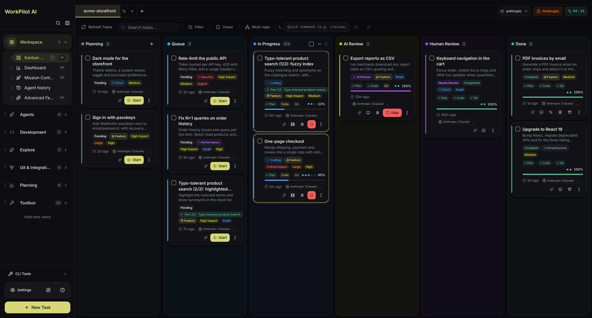

**[Télécharger](#télécharger)** · **[Démarrage rapide](#démarrage-rapide)** · **[Fonctionnement](#fonctionnement)** · **[Visite](#visite-de-lapplication)** · **[Features](#les-features-en-bref)** · **[Providers d'IA](#providers-dia)** · **[Documentation](#documentation)**

WorkPilot AI est une application de bureau (Windows, macOS, Linux) avec un moteur Python, un serveur d'équipe optionnel et une app mobile. Elle fonctionne sur toutes les stacks : .NET, Java, Kotlin, Go, Rust, Python, Node.js et TypeScript (Angular, React, Vue, Next.js, Nuxt…), PHP, Ruby, Flutter, Swift et d'autres.

> Les captures montrent l'interface en anglais ; l'application est entièrement disponible en français (Paramètres > Langue).

---

## Télécharger

### Version stable

<!-- STABLE_VERSION_BADGE -->
[](https://github.com/krovomi/WorkPilot-AI/releases/tag/v1.4.0)
<!-- STABLE_VERSION_BADGE_END -->

<!-- STABLE_DOWNLOADS -->
| Plateforme | Téléchargement |
|------------|----------------|
| **Windows** | [WorkPilot-AI-1.4.0-win32-x64.exe](https://github.com/krovomi/WorkPilot-AI/releases/download/v1.4.0/WorkPilot-AI-1.4.0-win32-x64.exe) |
| **macOS (Apple Silicon)** | [WorkPilot-AI-1.4.0-darwin-arm64.dmg](https://github.com/krovomi/WorkPilot-AI/releases/download/v1.4.0/WorkPilot-AI-1.4.0-darwin-arm64.dmg) |
| **macOS (Intel)** | [WorkPilot-AI-1.4.0-darwin-x64.dmg](https://github.com/krovomi/WorkPilot-AI/releases/download/v1.4.0/WorkPilot-AI-1.4.0-darwin-x64.dmg) |
| **Linux** | [WorkPilot-AI-1.4.0-linux-x86_64.AppImage](https://github.com/krovomi/WorkPilot-AI/releases/download/v1.4.0/WorkPilot-AI-1.4.0-linux-x86_64.AppImage) |
| **Linux (Debian)** | [WorkPilot-AI-1.4.0-linux-amd64.deb](https://github.com/krovomi/WorkPilot-AI/releases/download/v1.4.0/WorkPilot-AI-1.4.0-linux-amd64.deb) |
| **Linux (Flatpak)** | [WorkPilot-AI-1.4.0-linux-x86_64.flatpak](https://github.com/krovomi/WorkPilot-AI/releases/download/v1.4.0/WorkPilot-AI-1.4.0-linux-x86_64.flatpak) |
<!-- STABLE_DOWNLOADS_END -->

### Version bêta

> Les versions bêta peuvent contenir des bugs et des changements incompatibles. [Toutes les versions](https://github.com/krovomi/WorkPilot-AI/releases)

<!-- BETA_VERSION_BADGE -->
[](https://github.com/krovomi/WorkPilot-AI/releases)
<!-- BETA_VERSION_BADGE_END -->

<!-- BETA_DOWNLOADS -->
_Aucune version bêta n'est publiée pour le moment. Le tableau ci-dessus est la dernière version stable._
<!-- BETA_DOWNLOADS_END -->

> Chaque version contient les sommes de contrôle SHA256, un SBOM CycloneDX (`workpilot-sbom.cdx.json`) et une attestation de provenance de build pour chaque fichier (`gh attestation verify <fichier> --repo krovomi/WorkPilot-AI`) ; les résultats d'analyse VirusTotal sont ajoutés aux notes de version quand l'analyse est configurée.


---

## Démarrage rapide

1. **Installez** l'application pour votre plateforme depuis le [tableau de téléchargement](#télécharger).
2. **Ouvrez un projet** : n'importe quel dossier qui est un dépôt git.
3. **Connectez un provider d'IA** : un abonnement Claude, une clé d'API (OpenAI, Gemini, Grok, Mistral, DeepSeek), GitHub Copilot, un modèle local (Ollama, LM Studio) ou un agent CLI (Codex, OpenCode, pi…).
4. **Créez une tâche** sur le tableau Kanban et décrivez ce que vous voulez.
5. **Relisez le résultat** : les agents planifient, codent et valident ; vous approuvez le plan si vous le souhaitez, puis vous relisez le diff et fusionnez.

Depuis les sources (Node.js 22.12+, pnpm, Python 3.12+, Git) :

```sh
git clone https://github.com/krovomi/WorkPilot-AI.git
cd WorkPilot-AI
pnpm install
pnpm run dev
```

Installation pas à pas, configuration des providers, notes Windows et dépannage : [docs/INSTALLATION.md](docs/INSTALLATION.md).

---

## Fonctionnement

```
 votre tâche ─▶ spec ─▶ planner ─▶ coder (+ sous-agents) ─▶ QA reviewer ─▶ QA fixer
                           │                                      │
              sous-tâches que vous pouvez approuver   vérification : lancer l'app, garder une preuve
                                                                  │
                                                 votre revue ─▶ merge ou pull request
```

- **Isolé** : chaque tâche tourne dans son propre worktree git, votre branche reste intacte jusqu'au merge.
- **Un workflow par type de tâche** : un bug est reproduit avant d'être corrigé, une investigation écrit un rapport et aucun code, un refactoring n'a pas le droit de toucher aux tests, un hotfix reçoit une revue indépendante ([types de tâches](docs/architecture/kanban-task-types.md)).
- **De petites pull requests** : une tâche qui dépasse le plafond de revue de son type se découpe d'elle-même en parties, une petite PR chacune, empilées quand elles dépendent l'une de l'autre ([découpage des tâches](docs/architecture/task-split.md)).
- **Des preuves, pas des avis** : après la QA, l'application modifiée par la tâche est lancée et pilotée (web, Electron, émulateur mobile, API, bureau Windows), et des portes strictes vérifient les dépendances ajoutées et que les tests détectent vraiment les défauts.
- **N'importe quel moteur** : changez de provider, de modèle ou d'effort par tâche, même en cours de route ; ce que chaque provider sait faire est déclaré dans [`capabilities/providers.yaml`](capabilities/providers.yaml).

---

## Visite de l'application

> Chaque capture vient de la vraie application, remplie avec un projet de démonstration inventé (`acme-storefront`), et est régénérée par [`scripts/readme-screenshots/`](scripts/readme-screenshots/).

**Tableau Kanban** (ci-dessus) : décrivez une tâche et suivez-la de la planification jusqu'à la pull request. Chaque carte montre sa phase, son avancement, le provider au travail et son sujet ; les parties d'une tâche découpée partagent une couleur et une marque « Partie k/N ». Les colonnes suivent le pipeline : Planification, File d'attente, En cours, Révision IA, Révision humaine, Terminé, plus Build rouge quand la CI du projet échoue sur la branche d'une tâche.

<table>
<tr>
<td width="50%" valign="top">

**Détail d'une tâche** : le plan découpé en sous-tâches avec les fichiers que chacune touche, les logs, les fichiers modifiés, les preuves visuelles et l'émulateur.

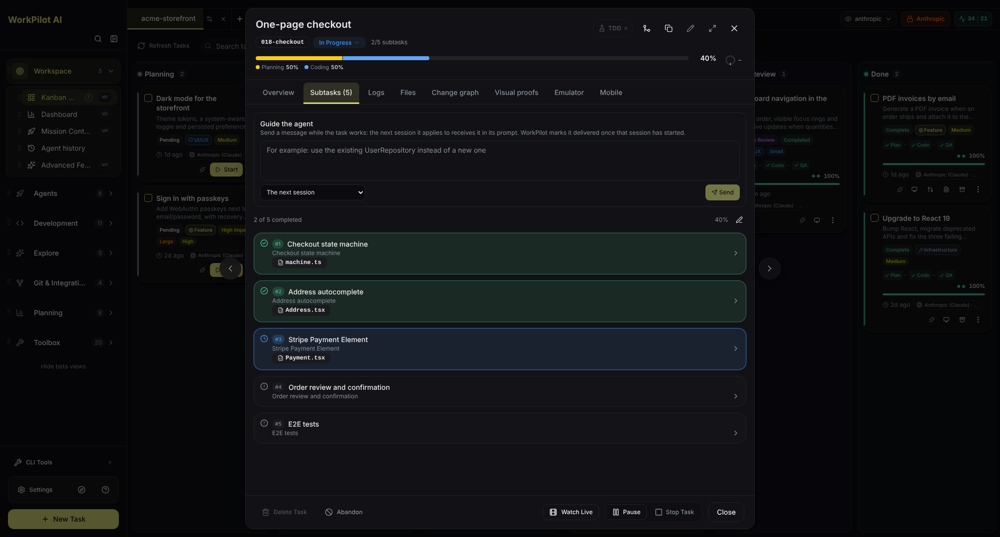

</td>
<td width="50%" valign="top">

**Terminaux d'agents** : jusqu'à 12 terminaux côte à côte, chacun dans le worktree d'une tâche, pour lancer des agents en parallèle à la main.

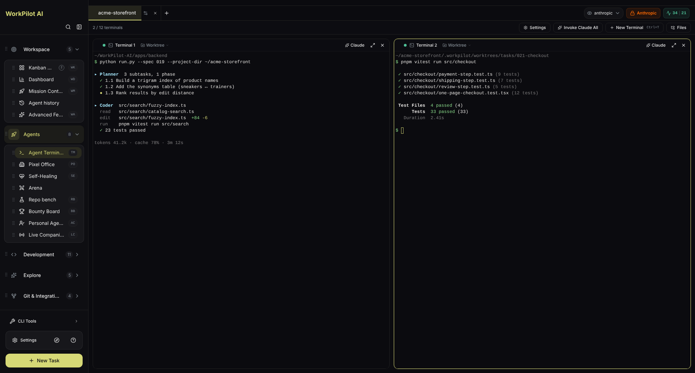

</td>
</tr>
<tr>
<td valign="top">

**Insights** : posez vos questions sur le code ; les réponses citent fichiers et lignes, et une trouvaille devient une tâche en un clic.

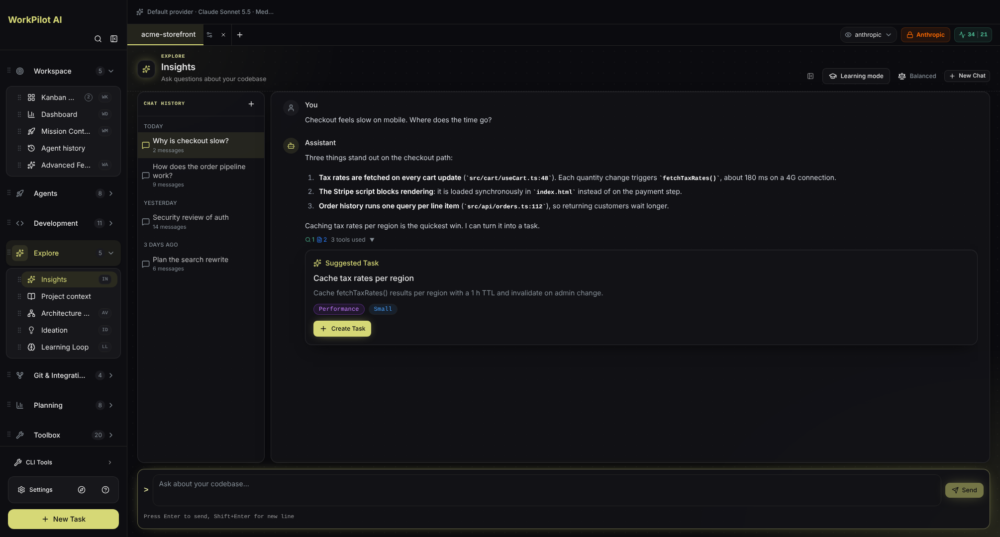

</td>
<td valign="top">

**Feuille de route** : vision produit, phases, priorités MoSCoW, concurrents et votes ; toute feature devient une tâche avec **Construire**.

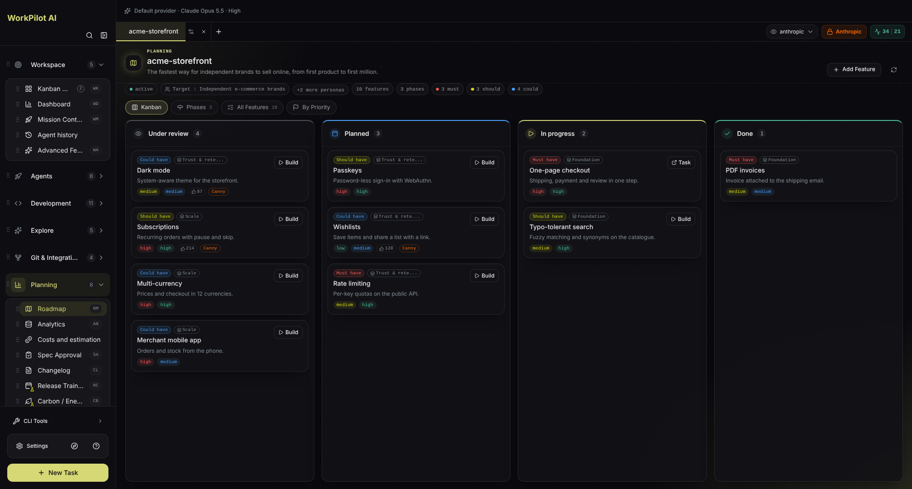

</td>
</tr>
<tr>
<td valign="top">

**Idéation** : les agents parcourent le projet et proposent des améliorations par type, chacune avec sa justification et ses fichiers.

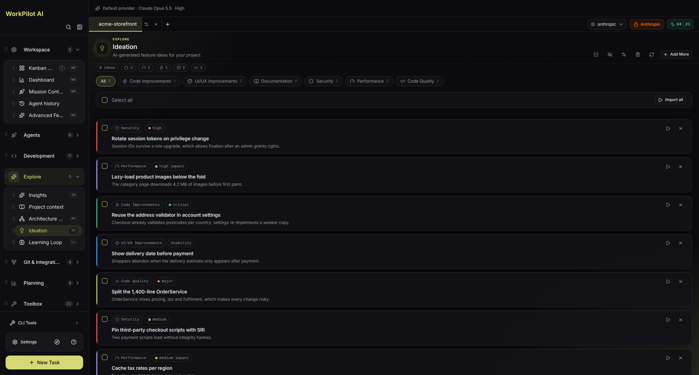

</td>
<td valign="top">

**Tableau de bord** : ce que les agents produisent et coûtent, par statut, provider et modèle ; exportable en JSON ou CSV.

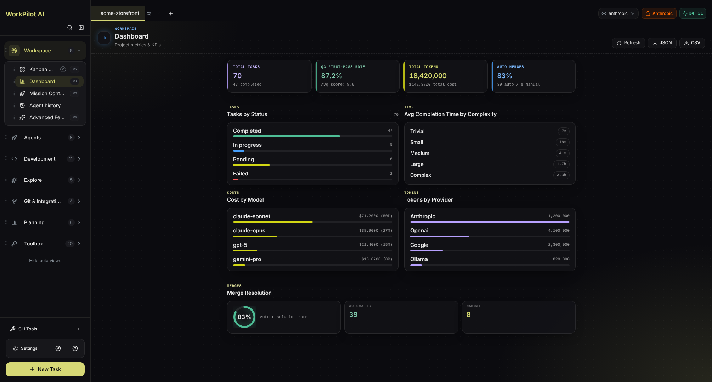

</td>
</tr>
<tr>
<td valign="top">

**Visuel vers Code** : dessinez l'architecture en graphe de nœuds, chaque liaison expliquée et vérifiée, puis générez le projet.

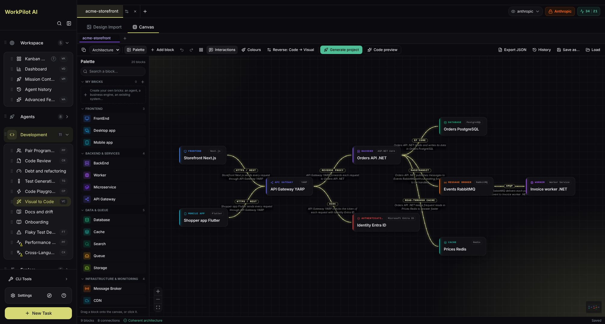

</td>
<td valign="top">

**Import Design** : une maquette, une capture ou un export Figma devient des composants de la stack du projet, en six étapes visibles.

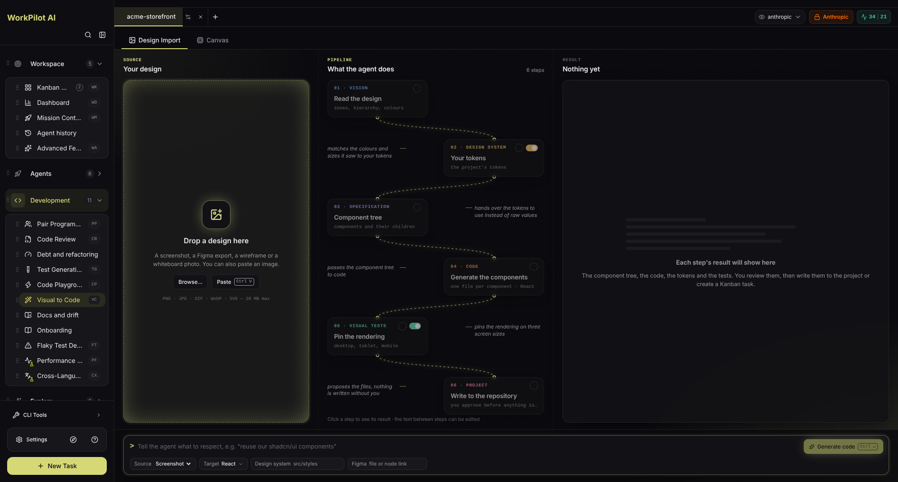

</td>
</tr>
<tr>
<td valign="top">

**Studio de génération de tests** : trous de couverture, tests unitaires, E2E ou TDD, écrits en direct dans le framework de la stack du fichier.

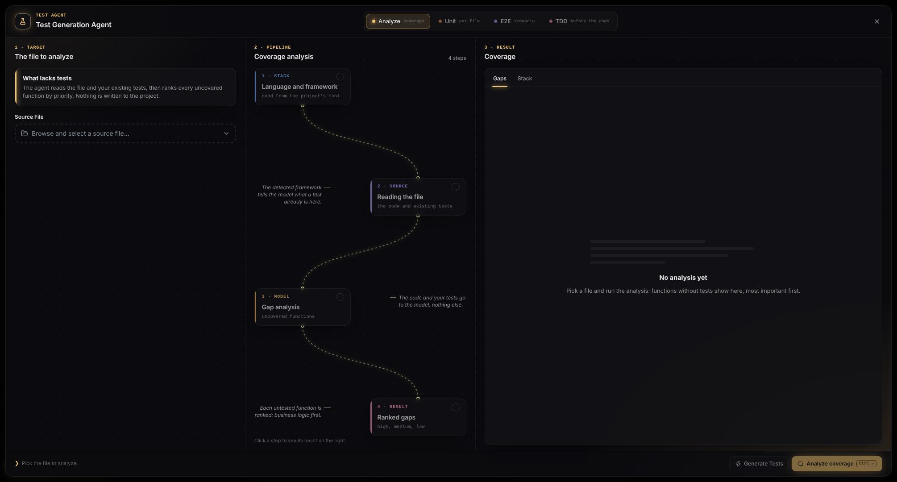

</td>
<td valign="top">

**Paramètres** : réglages de l'application et du projet regroupés par thème, dans la même charte graphique que tous les modules, aux couleurs du thème actif.

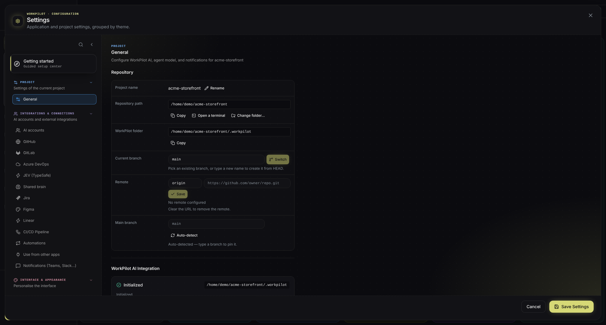

</td>
</tr>
</table>

**App mobile (iOS et Android)** : avec un serveur d'équipe, le tableau partagé dans votre poche : ouvrir une carte, approuver un plan, lancer ou arrêter les agents, lire le tableau de bord, les Insights, la feuille de route et les idées.

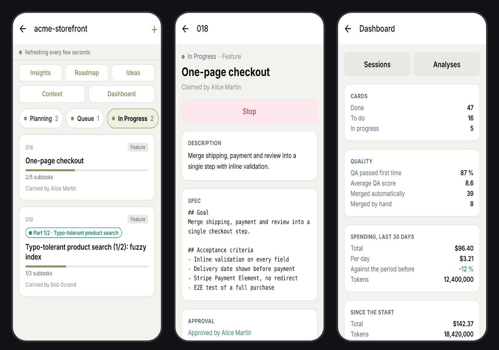

---

## Les features en bref

La liste complète, avec chaque détail, est dans **[docs/FEATURES.md](docs/FEATURES.md)** (en anglais). Les vues marquées _expérimentales_ dans la barre latérale (une fiole sur leur icône) n'ont pas encore de document de conception ni de test ; un bouton les masque toutes.

**Pipeline de construction**
- **Tableau Kanban** avec approbation de la spec, pause et reprise, relance par phase, messages de pilotage pendant que l'agent travaille, et une revue guidée avec des commentaires de ligne renvoyés au fixer.
- **Découpage automatique** des grosses tâches en petites PR groupées, **tâches empilées**, **Best-of-N** (construire une tâche 2 à 4 fois sur des moteurs différents et garder la meilleure) et changements **multi-dépôts**.
- **Mode objectif** (terminé quand une commande le dit, par exemple `dotnet test` qui sort en 0), **revue croisée** par un second moteur, **spec par l'exemple** pour les Web API ASP.NET Core, **montées de version .NET** une version à la fois jusqu'à .NET 11.
- **Vérification à l'exécution** avec vidéos de preuve et comparaison avec la branche de base ; **portes strictes** contre les paquets inventés, les tests sans mordant et pour les preuves formelles.
- **Suivi des PR** : un check rouge ou un fil de revue sur la PR de la tâche repart vers le fixer, jamais forcé, jamais fusionné.
- **Provenance** : quelles lignes l'IA a écrites et avec quel modèle, un SBOM des paquets ajoutés, la traçabilité exigence-test.

**Agents et orchestration**
- **Mission Control** pour lancer plusieurs agents sur un même objectif, **terminaux d'agents**, **Arène** et **Bounty Board** pour comparer les moteurs, **Repo bench** pour les mesurer sur vos propres tâches passées.
- Agents spécialisés : générateur de tests, détective de tests instables, refactoreur, docs et dérive, migration, coordinateur de release, auto-guérison sur échec de CI, suivi de la dette technique.
- **Mémoire partagée** : un coffre Obsidian et un graphe que tous les agents lisent et écrivent, entre sessions et providers ; des packs de **skills** indépendants du provider.

**Comprendre et planifier**
- **Insights**, **Idéation**, **Feuille de route**, visualiseur d'architecture, règles de revue de code et code smells pour chaque grande stack, classificateur de risque.
- **Visuel vers Code**, **Import Design**, **générateur de pipelines** (GitHub Actions, GitLab CI, Azure Pipelines, Bitbucket, CircleCI) et un **assistant vocal** (Ctrl+Maj+Espace).

**Intégrations**
- GitHub, GitLab, Azure DevOps, Jira et Linear : importer des tickets, les investiguer, relire des pull requests.
- Les **automatisations** transforment un événement (un ticket étiqueté, une CI rouge, une heure de la journée) en carte brouillon.
- Marketplace MCP et serveurs MCP personnalisés avec descriptions d'outils épinglées ; le serveur MCP **workpilot-board** donne votre Kanban à Claude Code, Codex, Gemini CLI, Copilot, Cursor et d'autres.
- Notifications sur Slack, Teams, Discord, Google Chat, webhooks, ntfy et Telegram.

**Équipe**
- **Mode serveur** : un serveur pour l'équipe, toutes les features partagées en direct, organisations isolées, rôles, groupes et administrateurs, connexion JWT ou Microsoft Entra ([guide d'exploitation](docs/server-operations.md)).
- **App mobile** pour iOS et Android, chat d'équipe, inscription sur invitation uniquement.

**Coûts et suivi**
- Tableau de bord analytique, estimateur de coûts, Formula Lab (estimation du coût et de la réussite par provider, modèle et effort), moniteur de limites de débit avec bascule de compte, profileur carbone, traces OpenTelemetry GenAI pour chaque provider.

**Apparence**
- Une seule charte graphique dans tous les modules, qui suit le thème actif : 7 thèmes de couleur en clair et en sombre plus un éditeur de thème, palette de commandes, interface complète en anglais et en français.

---

## Providers d'IA

| Provider | Connexion |
|----------|-----------|
| **Anthropic Claude** | Connexion Claude Code (abonnement), ou un profil d'API : une URL de base et son jeton |
| **OpenAI** | Clé d'API, ou la CLI Codex connectée |
| **Google Gemini** | Clé d'API, ou Gemini CLI via l'Agent Client Protocol |
| **Grok (xAI)**, **Mistral**, **DeepSeek** | Clé d'API |
| **GitHub Copilot** | Connexion GitHub (abonnement Copilot) |
| **Windsurf** | Clé d'API, ou la clé de l'IDE Windsurf installé |
| **Modèles locaux** | Ollama, LM Studio ou llama.cpp, sans clé |
| **Agents CLI** | Codex, OpenCode, Antigravity, pi, Hermes : installés et mis à jour en un clic depuis la barre latérale **Outils CLI** |

Plusieurs comptes peuvent être enregistrés par provider ; quand l'un atteint sa limite de débit, le suivant prend le relais. Les clés sont stockées dans le trousseau du système et affichées masquées ; l'interface ne reçoit jamais leur valeur. Meta, AWS et Cursor peuvent être configurés mais n'ont pas encore de client d'agent : leurs builds tournent sur Claude, et la tâche le signale. Variables et valeurs par défaut : [docs/CONFIGURATION.md](docs/CONFIGURATION.md) (en anglais).

---

## Architecture

```
WorkPilot-AI/
├── apps/
│   ├── backend/     # Agents Python, specs, QA, API locale, mode serveur
│   ├── frontend/    # App de bureau Electron (React + TypeScript)
│   └── mobile/      # App iOS et Android (Expo), cliente du mode serveur
├── src/             # Connecteurs Python partagés (Jira, Azure DevOps…)
├── capabilities/    # Ce que sait faire chaque provider et harness
├── config/          # Liste des providers affichée dans les Paramètres
├── workflows/       # Un workflow déclaratif par type de tâche
├── skills/          # Packs de skills (.agents/skills/ est généré)
├── deploy/          # Image serveur et docker-compose
├── changelog.d/     # Un fragment de changelog par pull request
├── docs/            # Règles, justifications de conception, guides
├── tests/           # Tests Python (les tests frontend sont à côté du code)
└── scripts/         # Scripts de build, de release et de maintenance
```

Comment les pièces s'assemblent (agents, sous-agents, workflows, état, couches de sécurité) : [docs/ARCHITECTURE.md](docs/ARCHITECTURE.md). Pourquoi chaque feature est construite ainsi : [docs/architecture/](docs/architecture/). Un atlas guidé et cliquable, lisible sans bagage technique : [docs/audit/WorkPilot-architecture.html](docs/audit/WorkPilot-architecture.html). Les instructions pour les agents de code commencent à [`AGENTS.md`](AGENTS.md).

### Ligne de commande

```bash
cd apps/backend
python runners/spec_runner.py --interactive   # Créer une spec en mode interactif
python run.py --spec 001                      # Lancer le build autonome
python run.py --spec 001 --review             # Relire
python run.py --spec 001 --merge              # Fusionner
```

Référence complète : [docs/CLI-USAGE.md](docs/CLI-USAGE.md) (en anglais).

---

## Sécurité

1. **Bac à sable du système** : les commandes des agents tournent sous bubblewrap (Linux) ou Seatbelt (macOS) ; Windows n'est pas encore couvert, et la carte indique quand une tâche tourne sans bac à sable.
2. **Restrictions du système de fichiers** : les opérations restent dans le dossier du projet.
3. **Liste blanche dynamique de commandes** : seules les commandes de la stack détectée sont autorisées.

Les clés d'API et les jetons sont chiffrés au repos avec le trousseau du système ; Paramètres > Comptes indique depuis quand chaque clé d'API a été enregistrée et suggère de la renouveler après 90 jours. Chaque version fournit les sommes de contrôle SHA256, un SBOM CycloneDX et une attestation de provenance de build par fichier.

Pour signaler une vulnérabilité, suivez [docs/SECURITY.md](docs/SECURITY.md), jamais un ticket public. Les règles que suivent les contributeurs et les agents de code sont dans [docs/rules/security.md](docs/rules/security.md).

---

## Documentation

| Document | Contenu |
|----------|---------|
| [Features](docs/FEATURES.md) | Chaque feature, par domaine (en anglais) |
| [Installation](docs/INSTALLATION.md) | Prérequis, méthodes d'installation, configuration des providers, notes Windows, dépannage |
| [Configuration](docs/CONFIGURATION.md) | Registre des providers, résolution des identifiants, variables d'environnement (en anglais) |
| [Utilisation en CLI](docs/CLI-USAGE.md) | Usage sans interface et en CI (en anglais) |
| [Architecture](docs/ARCHITECTURE.md) | Agents, workflows, état et couches de sécurité |
| [Justifications de conception](docs/architecture/) | Pourquoi chaque feature est construite ainsi, un fichier par feature |
| [Exploitation du serveur](docs/server-operations.md) | Faire tourner le serveur d'équipe : déploiement, TLS, sauvegardes, mises à jour, quotas |
| [Linux](docs/linux.md) · [Développement sous Windows](docs/windows-development.md) | Notes par plateforme (en anglais) |
| [Contribuer](docs/CONTRIBUTING.md) | Environnement de développement, style de code, tests, pull requests (en anglais) |
| [Processus de release](docs/RELEASE.md) | Comment les versions sont préparées et publiées (en anglais) |
| [Politique de sécurité](docs/SECURITY.md) | Versions supportées, signaler une vulnérabilité (en anglais) |
| [Plan de la documentation](docs/README.md) | Où vit chaque document et à quoi il sert |
| [Wiki](https://github.com/krovomi/WorkPilot-AI/wiki) | Guides utilisateur, rafraîchis après chaque version |

---

## Contribuer et communauté

Les contributions sont les bienvenues : commencez par [docs/CONTRIBUTING.md](docs/CONTRIBUTING.md). Les pull requests ciblent `develop`.

- **Tickets** : [signaler un bug ou demander une feature](https://github.com/krovomi/WorkPilot-AI/issues)
- **Discussions** : [poser une question](https://github.com/krovomi/WorkPilot-AI/discussions)

---

## Licence

**AGPL-3.0**, GNU Affero General Public License v3.0. WorkPilot AI est libre d'utilisation. Si vous le modifiez et le distribuez, ou le faites tourner comme service, votre code doit aussi être open source sous AGPL-3.0. Une licence commerciale est disponible pour les usages en source fermée.

[](https://github.com/krovomi/WorkPilot-AI/stargazers)

[](https://star-history.com/#krovomi/WorkPilot-AI&Date)
