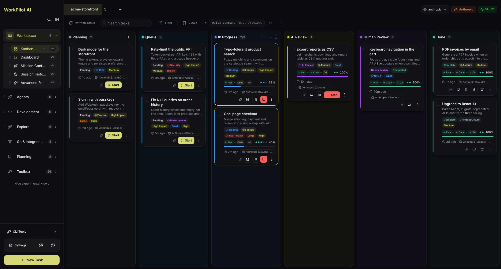
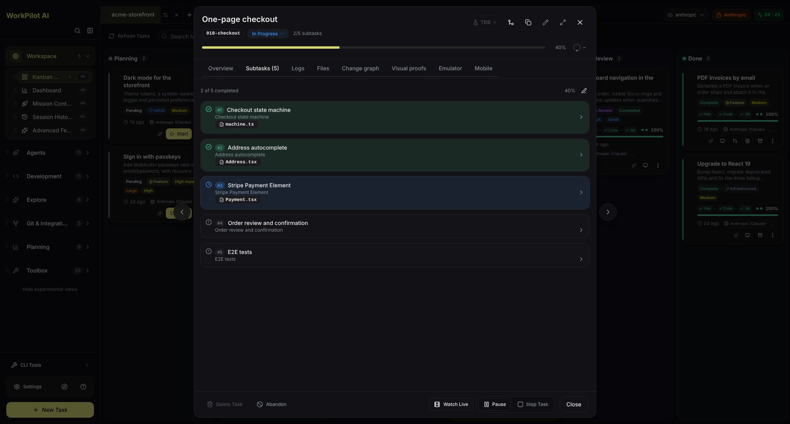
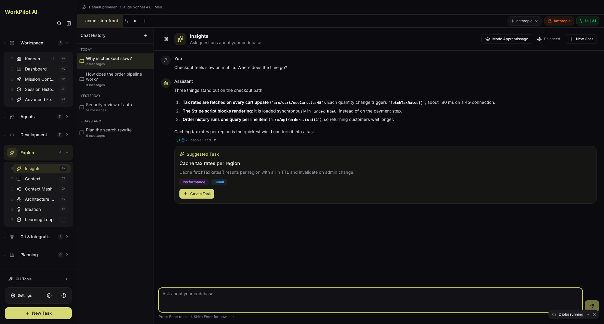
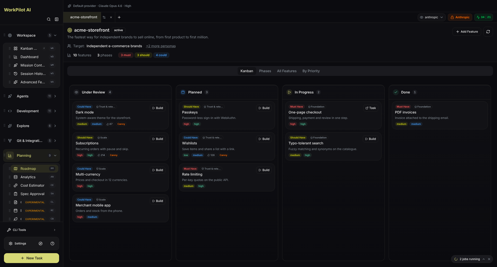
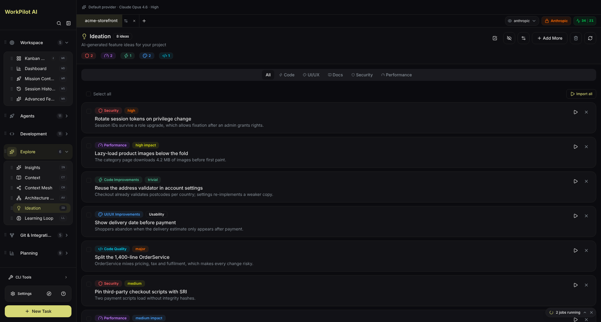
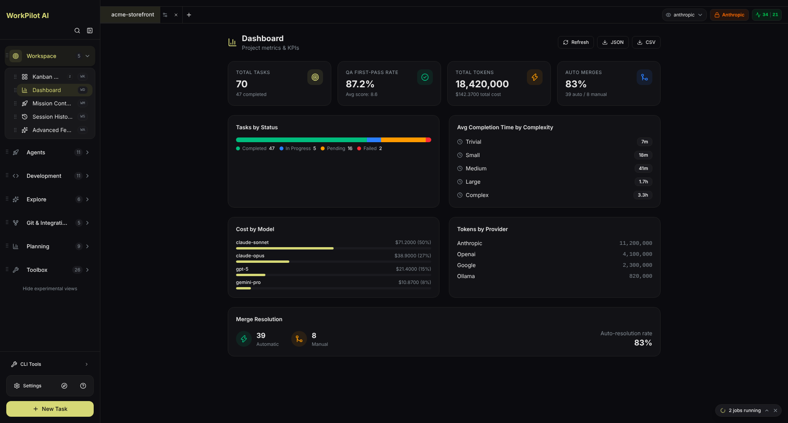
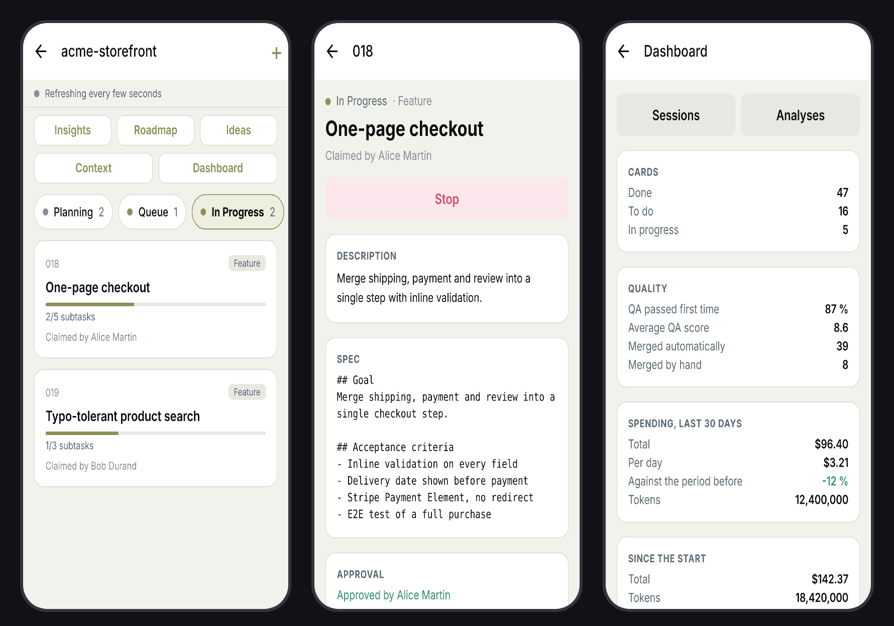

# WorkPilot AI

**Autonomous multi-agent coding framework that plans, builds, and validates software for you.**


[](./LICENSE)
[](https://discord.gg/KCXaPBr4Dj)
[](https://www.youtube.com/@AndreMikalsen)
[](https://github.com/krovomi/WorkPilot-AI/actions)

---

## Download

### Stable Release

<!-- STABLE_VERSION_BADGE -->
[](https://github.com/krovomi/WorkPilot-AI/releases/tag/v1.3.3)
<!-- STABLE_VERSION_BADGE_END -->

<!-- STABLE_DOWNLOADS -->
| Platform | Download |
|----------|----------|
| **Windows** | [WorkPilot-AI-1.3.3-win32-x64.exe](https://github.com/krovomi/WorkPilot-AI/releases/download/v1.3.3/WorkPilot-AI-1.3.3-win32-x64.exe) |
| **macOS (Apple Silicon)** | [WorkPilot-AI-1.3.3-darwin-arm64.dmg](https://github.com/krovomi/WorkPilot-AI/releases/download/v1.3.3/WorkPilot-AI-1.3.3-darwin-arm64.dmg) |
| **macOS (Intel)** | [WorkPilot-AI-1.3.3-darwin-x64.dmg](https://github.com/krovomi/WorkPilot-AI/releases/download/v1.3.3/WorkPilot-AI-1.3.3-darwin-x64.dmg) |
| **Linux** | [WorkPilot-AI-1.3.3-linux-x86_64.AppImage](https://github.com/krovomi/WorkPilot-AI/releases/download/v1.3.3/WorkPilot-AI-1.3.3-linux-x86_64.AppImage) |
| **Linux (Debian)** | [WorkPilot-AI-1.3.3-linux-amd64.deb](https://github.com/krovomi/WorkPilot-AI/releases/download/v1.3.3/WorkPilot-AI-1.3.3-linux-amd64.deb) |
| **Linux (Flatpak)** | [WorkPilot-AI-1.3.3-linux-x86_64.flatpak](https://github.com/krovomi/WorkPilot-AI/releases/download/v1.3.3/WorkPilot-AI-1.3.3-linux-x86_64.flatpak) |
<!-- STABLE_DOWNLOADS_END -->

### Beta Release

> Beta releases may contain bugs and breaking changes. [View all releases](https://github.com/krovomi/WorkPilot-AI/releases)

<!-- BETA_VERSION_BADGE -->
[](https://github.com/krovomi/WorkPilot-AI/releases)
<!-- BETA_VERSION_BADGE_END -->

<!-- BETA_DOWNLOADS -->
_No beta build is currently published. The table above is the latest stable release._
<!-- BETA_DOWNLOADS_END -->

> All releases include SHA256 checksums, a CycloneDX SBOM (`workpilot-sbom.cdx.json`) and a build provenance attestation for each file (`gh attestation verify <file> --repo krovomi/WorkPilot-AI`); VirusTotal scan results are added to the release notes when the scan is configured.

---

## Quick Start

1. **Download and install** the app for your platform
2. **Open your project** — select a git repository folder
3. **Connect your AI provider** — Claude (OAuth), API key, or any OpenAI-compatible endpoint
4. **Create a task** — describe what you want to build
5. **Watch it work** — agents plan, code, and validate autonomously

Or from source:

```sh
pnpm install
pnpm run dev
```

See [Installation et Configuration](#installation-et-configuration) below for detailed instructions.

---

## Features

### Autonomous Development Pipeline

| Feature | Description |
|---------|-------------|
| **Kanban Board** | Visual task management from planning through completion with real-time agent progress |
| **Multi-Agent Pipeline** | Planner → Coder → QA Reviewer → QA Fixer pipeline runs autonomously end-to-end |
| **Parallel Execution** | Up to 12 simultaneous agent terminals for parallel builds |
| **Isolated Workspaces** | Every task runs in a dedicated git worktree — your main branch stays safe |
| **AI-Powered Merge** | Semantic conflict resolution when integrating worktrees back to main |
| **QA Auto-Fix Loop** | Agents automatically detect, fix, and revalidate failing acceptance criteria |
| **Runtime Verification** | After QA, the `verify` phase launches the app the task changed, reads every error, fixes and relaunches, drives the app to the state the task asked for and keeps a proof: web and Electron apps through Chrome DevTools, mobile apps on an emulator, APIs through their OpenAPI schema, and WPF, WinForms or WinUI apps through Windows UI Automation, in the one window the card names and never by simulated keystrokes. A card can also list, in plain language, the steps that prove a web change: the verifier follows them in Playwright, captures each step and attaches the Playwright trace to the card; a step not carried out is never a pass |
| **Spec Approval Workflow** | Review and approve AI-generated specifications before implementation begins |
| **Hot-Swap LLM** | Change provider, model, or reasoning effort mid-task — the next turn resumes on the new engine with context replayed |
| **Honest Effort** | Each provider gets the effort level on its own scale (Claude, OpenAI/Codex, Gemini, Grok, DeepSeek, Mistral, Copilot, Ollama, pi, Antigravity); the picker and the task log say what the model actually receives, and a model that refuses the setting runs on without it instead of failing the phase |
| **Pause & Resume** | Suspend a running task and resume later with full context preserved, optionally on a different provider |
| **Per-Phase Re-run** | Redo any phase (planning, coding, validation) on demand without restarting the whole task |
| **PR-First Review Flow** | Guided human-review with a DoD checklist, "approve & close", and reversible task abandon |
| **PR Follow-Through** | Once the task's PR is open, the card keeps driving it: a red check or an unresolved review thread goes to the QA fixer in the task's worktree, the commit is checked (no test skipped or deleted, no CI file edited) and pushed — never forced, never merged. A failure that is also red on the base branch is reported, not "fixed". GitHub for now — see [docs/architecture/pr-followup.md](docs/architecture/pr-followup.md) |
| **GenAI Traces for Every Provider** | Set one OTLP endpoint and every provider's sessions show up the same way in Jaeger, Langfuse or Phoenix: an agent span, its model calls with token counts, its tool calls. No prompt or output leaves; a provider that reports no usage is marked "estimated", never counted as zero |
| **OS Sandbox** | An agent's commands run under bubblewrap (Linux) or Seatbelt (macOS): writes stay in the task's worktree, your SSH keys and tokens are hidden, the network is the provider's hosts and the package registries through a filtering proxy. When the machine has no sandbox the card says so at launch; `WORKPILOT_SANDBOX=required` refuses to start instead. Windows is not covered yet — see [docs/architecture/os-sandbox.md](docs/architecture/os-sandbox.md) |
| **MCP 2026: Tasks and MCP Apps** | WorkPilot's own MCP servers speak MCP 2026-07-28 and still answer older clients as before. `verify_launch`, `verify_perf_trace` and `verify_device` come back as tasks to a client that reads them: polled, cancelled when the build stops, timed out. A tool of an installed MCP server that attaches a view shows it in the task panel, on every provider including Claude, in an iframe sandboxed without `allow-same-origin` and with the view's own CSP. The view shows the call that happened and cannot act on the task. See [docs/architecture/mcp-2026.md](docs/architecture/mcp-2026.md) |
| **Best-of-N** | Build one task 2 to 4 times, each in its own worktree with its own provider, model and effort; the card ranks them on numbers (finished build, QA, goal, diff size, cost) and you keep the one you choose. Nothing is merged on its own |
| **Goal Mode** | A task is done when a command says so (`dotnet test` exits 0), not when a reviewer thinks so: QA keeps fixing within a pass and spending cap, and the tests it must pass are protected from edits |
| **Spec by Example (.NET)** | On an ASP.NET Core Web API, when the project turns it on, the spec's acceptance criteria are written as HTTP integration tests (`WebApplicationFactory`) before any code. WorkPilot checks they touch only the test project, compile and fail, then makes `dotnet test` the task's goal with those tests protected. A goal you set yourself is kept. See [docs/architecture/spec-by-example.md](docs/architecture/spec-by-example.md) |
| **Cross Review** | After QA, a second engine (another provider and model, chosen per project) reads the diff against the spec and the goal. If it names a blocking problem, the pull request waits for you: fix it, or create it anyway. An answer it cannot read is never taken as approval. See [docs/architecture/cross-review.md](docs/architecture/cross-review.md) |
| **Board over MCP** | The `workpilot-board` MCP server gives Claude Code, Codex or Gemini CLI in a terminal the project's Kanban: list and read cards, add one to the backlog, wait until a card is ready for your review. Starting a build, approving a plan and merging stay with you, on the card. See [docs/architecture/board-mcp.md](docs/architecture/board-mcp.md) |
| **Needs You** | When a task waits for you (plan, review, QA hand-over, error), you hear about it on the desktop and, if you want, on ntfy or Telegram; a waiting plan can be approved from Telegram with a one-shot button |
| **Automations** | A rule turns an event into a Kanban card: a GitHub issue labelled, the base branch's CI going red, a time of day. Cards are drafts by default, one per issue or red streak, under a daily cap; a rule never merges, pushes or comments. A PR opened by someone else gets the AI review instead, kept as an unposted draft in GitHub PRs until you post it |
| **ACP Agents** | Any agent that speaks the Agent Client Protocol runs a task from one entry in `capabilities/providers.yaml`, Gemini CLI first. A question the agent asks before acting appears on the card with its options; the agent type's tool rights are held by the session mode, by refusing questions outside them, and by stopping a turn that runs an undeclared tool. The sidebar lists only the capabilities the agent declares — see [docs/architecture/acp.md](docs/architecture/acp.md) |
| **Declarative Workflows** | A build is described as phases in `workflows/<name>/workflow.yaml`; the engine resolves them against your effort level, the provider's capabilities, the files the task touches and the task itself (`when: kind == … and complexity == …`). On by default |
| **One Workflow per Task Kind** | A card's kind (`feature`, `bug_fix`, `hotfix`, `investigation`, `run`, `refactoring`, `test`, `docs`, `spike`) is decided without a model from its category, imported item type or wording, shown and editable on the card, and picks the workflow that runs: a bug is reproduced before it is fixed, an investigation writes a report and no code, a RUN writes a procedure a person reads first, then plays it with Python behind the command allowlist, pausing before anything irreversible. Every implementation a workflow names resolves on a fresh clone, on every provider |
| **Optional Methodologies by `fallback:`** | A phase may name a methodology that needs a runtime in the target project (BMAD's `_bmad/`) and a WorkPilot fallback; the engine substitutes the fallback when the runtime is absent and shows it in the profile. Nothing is skipped in silence |
| **Resolved Profile Preview** | See which phases your effort setting bought — and what the next level up would add — in the task detail modal, *before* the build starts |

### Multi-Agent Orchestration

| Feature | Description |
|---------|-------------|
| **Mission Control** | NASA-style dashboard for orchestrating multiple agents simultaneously — live status, token consumption, file changes, and per-agent reasoning |
| **Agent Replay & Debug** | Step-by-step replay of any agent session with timeline navigation, file diffs, breakpoints, and token heatmaps |
| **Decision Logger** | Real-time visualization of agent decision trees and trade-off rationale |
| **Consensus Arbiter** | Reconciles conflicting opinions from security scans and QA reviewers into a single verdict |
| **Agent Coach** | Analyzes real usage to suggest cheaper models, better effort levels, and prompt tweaks per agent |
| **Pair Programming** | Interactive real-time AI coding partner with live suggestions and conversation-driven development |
| **Learning Mode** | Educational mode with step-by-step explanations of agent decisions |

### Specialized Agents

| Agent | Role |
|-------|------|
| **Planner** | Complexity assessment, phased subtask breakdown, dependency analysis |
| **Coder** | Context-aware implementation with parallel subagent spawning |
| **QA Reviewer / Fixer** | Acceptance criteria validation and automated issue resolution |
| **Test Generator** | Unit and integration test generation with live streaming of the code as it is written |
| **Flaky Test Detective** | Parses test reports (JUnit XML, .NET TRX, …) to surface intermittently failing tests |
| **Refactorer** | Safe code refactoring with pattern detection and API migration |
| **Documenter** | README, API docs, and architecture documentation generation |
| **Migration Agent** | Framework and library migration with breaking change detection |
| **Release Coordinator** | Orchestrates release readiness, changelog, and version bumps |
| **Memory Manager** | The shared brain: one Obsidian vault every agent reads and writes, across sessions |

### Integrations

| Platform | Capabilities |
|----------|-------------|
| **GitHub** | Import issues, AI investigation, PR review, batch review wizard, auto-PR creation |
| **GitLab** | Issues and merge request management with AI severity categorization |
| **Azure DevOps** | Work item import, PR review, batch operations — _experimental: the PR details view (file list, diff stats) falls back to placeholder data when the Azure DevOps call fails, see [docs/CONFIGURATION.md](docs/CONFIGURATION.md#mock--stub-behaviors-to-be-aware-of)_ |
| **Linear** | Bulk issue import with team/project filtering |
| **Jira** | Issue management integration |
| **MCP Marketplace** | Browse, install, and configure Model Context Protocol servers |
| **Custom MCPs** | Define and host custom MCP servers with local authentication |
| **Windsurf** | Windsurf IDE integration via Connect protocol |

### AI Providers & Authentication

| Provider | Auth Method |
|----------|-------------|
| **Anthropic Claude** | OAuth (subscription) or API key |
| **OpenAI** | OAuth (subscription) or API key |
| **Google Gemini** | API key |
| **Grok / xAI** | API key |
| **Ollama** | Local endpoint |
| **Azure OpenAI** | API key + endpoint |
| **GitHub Copilot** | OAuth (subscription) or API key |
| **Custom endpoints** | Any OpenAI-compatible API (e.g. z.ai for GLM models) |

**Multi-account switching** — Register multiple profiles per provider. WorkPilot AI automatically switches to an available account when one hits a rate limit.

**Keys stay out of the interface** — Once saved, a key or token shows up masked in every screen. Connection tests run in the app's main process. If you change a profile's base URL, you are asked for its key again: a saved key is only sent to the URL it was saved for.

### Code Intelligence

| Feature | Description |
|---------|-------------|
| **Insights** | AI chat interface for exploring and understanding your codebase with semantic search |
| **Ideation** | Discovers performance bottlenecks, security vulnerabilities, code quality issues, and UI/UX improvements |
| **Architecture Visualizer** | Dependency graphs, module hierarchy, and component relationship diagrams |
| **Performance Profiler** | AI-powered bottleneck identification with optimization suggestions |
| **Dependency Sentinel** | Monitors security vulnerabilities, version conflicts, and outdated dependencies |
| **Self-Healing Codebase** | Automatically generates fixes when CI tests fail; integrates with Sentry, Datadog, PagerDuty for production incidents |
| **Technical Debt Tracker** | Continuously scores code health, tracks and ages debt items, and proposes auto-fixes with PRs |
| **Risk Classifier** | Scores code changes by risk level with impact assessment |

### Developer Productivity

| Feature | Description |
|---------|-------------|
| **Guided Onboarding** | Setup Hub checklist plus a step-by-step coachmark tour to configure providers and integrations |
| **Roadmap** | AI-assisted feature planning with prioritization and phased rollout |
| **Changelog** | Auto-generates release notes from completed tasks |
| **Natural Language Git** | AI-generated semantic commit messages from diffs |
| **Auto-Refactoring** | Pattern-based and architectural code transformations |
| **Code Migration** | Large-scale codebase migrations across frameworks and libraries |
| **Design to Code** | Converts UI mockups and screenshots to React/HTML |
| **Pipeline Generator** | Generates GitHub Actions, GitLab CI, and Azure Pipelines configurations |
| **Browser Agent** | Autonomous browser interaction for E2E test generation and visual regression |
| **Arena Mode** | Side-by-side comparison of different AI models on the same task |
| **Voice Control** | Hands-free task and terminal control via speech-to-text |
| **Multi-Repo Orchestration** | Coordinate changes across multiple repositories simultaneously |
| **Code Playground** | Sandbox environment for testing code snippets in isolation |
| **Prompt Optimizer** | Analyzes and rewrites prompts for better AI output |

### Memory & Context

| Feature | Description |
|---------|-------------|
| **Memory System (shared brain)** | One Obsidian vault + `graph.json`, served over MCP — agents retain insights across sessions |
| **Skills System** | Provider-agnostic [Agent Skills](https://agentskills.io) packs under `.agents/skills/`, served to the Kanban command bar and mirrored per harness (Claude Code, Copilot, Codex, Cursor, Gemini); read natively by hermes and [pi](https://pi.dev) |
| **Memory Search** | Three-layer progressive retrieval over past builds — an index costs ~100 tokens, timelines and full records are fetched only on demand |
| **hermes-agent** | [hermes-agent](https://github.com/NousResearch/hermes-agent) skills are read from the same `.agents/skills/`; skills it authors arrive as *candidates* for review, never auto-adopted |
| **pi** | [pi](https://pi.dev) reads `AGENTS.md` and `.agents/skills/` natively and joins the shared brain (`~/.pi/agent/mcp.json`); project resources stay behind its own `/trust`, which WorkPilot never grants — see [docs/architecture/pi.md](docs/architecture/pi.md) |
| **Context Management** | Intelligent context building with file relevance ranking and dependency graph analysis |
| **Session History** | Browse and replay past agent sessions with full statistics |

### Analytics & Monitoring

| Feature | Description |
|---------|-------------|
| **Analytics Dashboard** | Token consumption, cost tracking, success rates, and execution time metrics — live SQLite-backed API; falls back to an explicit 503 when the analytics DB is unavailable |
| **Formula Lab** | Pre-flight cost/success estimation per Provider × Model × Effort, calibrated on your real usage history |
| **Repo Bench** | Replays 10 to 20 of your finished cards from the commit before them, once per engine, in isolated copies that do not hold the answer, and judges each build with the tests the card landed with — tests the agent never sees, kept only when they fail before the card and pass after it. The table says which provider × model × effort resolves your project's work, and per kind of card (bug fix, feature…) which engine to use: the cheapest one close to the best measured rate, offered on the card's engine step with its evidence, never applied for you. Formula Lab and the model router read it. See [docs/architecture/repo-bench.md](docs/architecture/repo-bench.md) |
| **Cost Estimator** | Per-task cost calculation with provider comparison and budget alerts |
| **Carbon Profiler** | Estimates the energy (kWh) and carbon footprint of your agent runs |
| **Rate Limit Monitor** | Real-time usage tracking with proactive warnings and auto-switching triggers |
| **Workflow Logger** | Structured execution logs with trace IDs for all agents, skills, and hooks |
| **Learning Loop** | Extracts patterns from completed builds and A/B-replays promoted changes, so a suggestion is backed by an observed run rather than a guess. Review comments the PR follow-up fixed and the feedback of rejected plans become rule candidates; once you adopt one, every build follows it |

### Customization

| Feature | Description |
|---------|-------------|
| **7 Color Themes** | Default, Dusk, Lime, Ocean, Retro, Neo, Forest — each with light and dark variants |
| **Custom Theme Editor** | Color picker with live preview, export, and import |
| **Bilingual UI** | Full French and English interface |
| **Command Palette** | Keyboard-driven access to all features with fuzzy search |
| **Plugin Marketplace** | Browse and install community plugins |

### Deployment & Team

| Feature | Description |
|---------|-------------|
| **Multi-User Server Mode** | Central deployment with JWT / Microsoft Entra auth, per-user claims, and a shared run manager |
| **Invitation-Only Signup** | Self-service registration gated by admin invitations, with SMTP delivery and rate limiting |
| **Notifications** | Multi-channel "PR ready" alerts (Slack, email, webhook) with SSRF hardening |

---

## Interface

> Every screenshot below comes from the real app, filled with an invented demo project (`acme-storefront`). They are regenerated with `scripts/readme-screenshots/`.

### Kanban Board
Describe a task, and agents take it from planning to a merged pull request. Each card shows its phase (plan, code, QA), its progress, the provider at work and what it is about (category, impact, priority). Columns follow the pipeline: Planning, Queue, In Progress, AI Review, Human Review, Done.


### Task Detail
Open a card to follow the agents live: the plan split into subtasks with the files each one touches, the logs, the changed files, the change graph, visual proofs and the emulator.



### Insights
Ask questions about your codebase. The assistant reads the code (the tools it used are listed), answers with file and line references, and turns a finding into a ready-to-run task in one click.



### Roadmap
AI-assisted feature planning: product vision, target audience, phases, MoSCoW priorities, competitor analysis and votes imported from Canny or GitHub. Any feature becomes a task with **Build**.



### Ideation
Agents scan the project and propose improvements by type: code, UI/UX, documentation, security, performance and code quality, each with its rationale and the files concerned.



### Dashboard
What the agents produce and cost: tasks by status, QA first-pass rate, tokens and cost by provider and model, merges resolved automatically, completion time by complexity. Exportable as JSON or CSV.



### Agent Terminals
AI-powered terminals with one-click task context injection. Spawn multiple agents for parallel work.


### Mission Control
NASA-style multi-agent orchestration hub with per-agent monitoring, model assignment, and live decision visualization.

### Mobile App (iOS & Android)
The team's board in your pocket: in server mode, the phone app follows the shared Kanban, opens a card (spec, approval, runs, changes), starts, approves or stops the agents, and reads the dashboard, Insights, roadmap and ideas. The agents keep running on the team server.



### Additional Views
- **Changelog** — Generate release notes from completed tasks
- **Architecture Visualizer** — Interactive dependency and module graphs
- **Agent Replay** — Step-by-step session replay with breakpoints and diffs
- **Analytics** — Usage, cost, and performance dashboards
- **Session History** — Every agent session with its phases, tokens and cost

---

## Architecture Détaillée

> Pour une lecture guidée — y compris sans prérequis technique — ouvrez l'atlas
> [`docs/audit/WorkPilot-architecture.html`](docs/audit/WorkPilot-architecture.html) (vue « Pour tous »,
> schémas cliquables, constats, feuille de route ; un fichier par constat depuis F113 dans
> [`docs/audit/findings/`](docs/audit/findings/)). Les justifications de conception sont dans
> [`docs/architecture/`](docs/architecture/).
>
> Les liens entre couches sont vérifiés par des tests qui lisent les sources : IPC dans les deux
> sens et canaux nommés par constante (`ipc-channel-parity.test.ts`), imports entre unités du
> backend et plafond du cycle principal, ramené de 81 à 10 unités par la couche `foundation/` et le port `agent_runtime`
> (`tests/test_import_contracts.py`), une ligne par vue dans
> [`product-overview.md`](docs/architecture/product-overview.md) (`tests/test_product_overview_views.py`).
>
> Une vue qui n'a encore ni document de conception ni test porte le badge « Expérimental » dans la
> barre latérale. Un bouton en bas de la barre les masque toutes. Chaque script de
> [`scripts/`](scripts/README.md) a sa ligne dans le README du dossier.

### Vue d'Ensemble

WorkPilot AI est une application de bureau autonome basée sur une architecture multi-agents qui orchestre le cycle de vie complet du développement logiciel. Le système combine un backend Python puissant avec une interface utilisateur Electron moderne pour offrir une expérience de développement transparente.

### Architecture Multi-Agents

#### Pipeline Autonome de Développement
1. **Agent Planner** - Analyse la complexité et décompose les tâches en sous-tâches
2. **Agent Coder** - Implémente les fonctionnalités avec des sous-agents parallèles
3. **Agent QA Reviewer** - Valide les implémentations selon les critères d'acceptation
4. **Agent QA Fixer** - Résout automatiquement les problèmes identifiés

C'est le parcours d'une **fonctionnalité** (`workflows/feature-build/workflow.yaml`). Le **type de la
carte** — décidé sans modèle à la création de la spec (`apps/backend/tasks/classify.py`), affiché et
modifiable sur la carte — choisit le workflow réellement joué (`apps/backend/workflows/registry.py`) :

| Type | Workflow | Ce qui change |
|---|---|---|
| `feature` (ou type inconnu) | `feature-build` | le parcours ci-dessus ; `prd` BMAD sur une feature complexe à `ultrathink` |
| `bug_fix` | `bug-fix` | `reproduce` d'abord (le test rouge, la cause probable), pas de brainstorm ni de carte d'architecture |
| `hotfix` | `hotfix` | `reproduce`, revue indépendante à tout effort, pas de préflight de docs |
| `investigation` | `investigation` | un rapport (`investigate`, lecture seule) et **aucun code** ; le coder n'est pas lancé |
| `run` | `run` | la procédure écrite (`runbook`), relue par une personne, puis jouée par Python derrière l'allowlist après une pause avant l'irréversible ; journal `workflow/run.md`, environnements déclarés dans `.workpilot/environments.toml` |
| `refactoring` | `refactoring` | gate `tests-unchanged` : le diff ne touche aucun test |
| `test` | `test` | plan, tests écrits en TDD, revue, suite verte |
| `docs` | `docs` | le document, relu contre le code (`proofread`), sans boucle QA |
| `spike` | `spike` | approches comparées, prototype jetable, `verdict` |

Détail et plan par lots : [`docs/architecture/kanban-task-types.md`](docs/architecture/kanban-task-types.md).

#### Agents Spécialisés
- **Test Generator** - Génération de tests unitaires et d'intégration
- **Refactorer** - Refactoring sécurisé du code avec détection de patterns
- **Documenter** - Génération automatique de documentation
- **Migration Agent** - Migration de frameworks et bibliothèques
- **Memory Manager** - Le cerveau partagé : un vault Obsidian lu et écrit par tous les agents

#### Sous-agents spécialisés
Les sous-agents ne sont pas déclarés par chaque agent : ils vivent dans **un seul registre**,
[`apps/backend/subagents/`](apps/backend/subagents/), et chaque session reçoit un
*roster* composé par `subagents.resolve()` depuis `core/client.py` :

1. **Défauts de phase** (`phases.py`) — p. ex. coder : `code-reviewer`, `test-runner`,
   `architecture-analyst` ; planner : `architecture-analyst`, `dependency-tracer` ;
   QA : `qa-acceptance-checker`, `test-runner` ; revue : `security-auditor`, `regression-hunter`,
   `test-coverage-auditor` ; les appels d'une seule réponse (message de commit…) n'en ont aucun.
2. **Overlays de langage** (`languages/` : .NET, Python, TypeScript, Java, Go, Rust) — la pile
   détectée injecte ses commandes (`dotnet test --nologo`…) dans le prompt du `test-runner`.
3. **Overlay mobile** — ajoute `device-runner` et `store-readiness-auditor` sur une app mobile.
4. **Agents fournis par l'appelant** — gagnent toujours (relecteurs de PR de `pr_review.py`).
5. **Plafond** de 7 sous-agents.

Le roster atteint le modèle sur tout provider (`capabilities/providers.yaml`) :
- `native` — Claude : `agents=` du SDK et son outil `Agent` ;
- `emulated` — Copilot, OpenAI, Gemini, Ollama / LM Studio, Mistral, DeepSeek, Grok, Windsurf :
  un outil `delegate` dont la description liste les spécialistes, et une **session enfant** du même
  client par délégation, avec les seuls outils du spécialiste et un résultat borné
  ([`docs/architecture/delegation.md`](docs/architecture/delegation.md)) ;
- `none` — les CLI (Codex, OpenCode, Antigravity, pi) apportent leurs outils et ne reçoivent pas de roster.

Ce que rend un sous-agent est borné et traité comme une donnée non fiable
(`harness/application/subagents.py`). Le même registre, plus les personas des packs
(`skills/dotnet/agents/net-architect.md`, `skills/mobile/agents/…`), est émis dans
`.agents/agents/` pour les IDE (Copilot, Codex, Claude Code) ; ces personas de pack ne font pas
partie des rosters du pipeline. Détail : [`apps/backend/agents/README.md`](apps/backend/agents/README.md#subagents).

#### Méthode BMAD
BMAD est une **capacité à la demande**, jamais une étape obligatoire : 50 skills BMAD v6.12.0
vendorisés dans [`skills/bmad/`](skills/bmad/) par `scripts/vendor_bmad.py`. Ils ont besoin du
runtime `_bmad/` que l'installeur BMAD écrit **dans le projet cible** (`pnpm run skills:bootstrap
--pack bmad`) ; sans lui, ils sont masqués de la barre de commandes. Dans les workflows, BMAD
n'entre que là où sa valeur est documentaire — `brainstorm` (`bmad-brainstorming`), le `prd` d'une
feature complexe à `ultrathink` (`bmad-prd`), la recherche d'un spike (`bmad-deep-recon`) — et
toujours avec un `fallback:` WorkPilot que le moteur substitue quand le projet n'a pas le runtime,
en l'écrivant dans le profil. Voir [`skills/README.md`](skills/README.md#runtime-gates) et
[`docs/architecture/kanban-task-types.md`](docs/architecture/kanban-task-types.md).

### Architecture Technique

#### Backend Python (`apps/backend/`)
```
apps/backend/
├── core/                # Racine de composition : fabrique de clients, authentification, worktree
│   ├── client.py        # Client Claude Agent SDK
│   ├── agent_clients/   # Un client par provider (OpenAI, Gemini, Copilot, Ollama, pi, ACP…)
│   ├── effort_plan.py   # L'effort réellement envoyé à chaque provider
│   ├── auth.py          # Gestion multi-profils OAuth
│   └── worktree.py      # Isolation des espaces de travail Git
├── foundation/          # Couche la plus basse, n'importe rien du backend (platform/, api_safety, git)
├── agents/              # Logique d'exécution des agents
│   ├── planner.py       # Agent de planification
│   ├── coder.py         # Agent de développement
│   ├── session.py       # Gestion des sessions
│   └── subagents/       # Registre des sous-agents (phases, langages, mobile, revue de PR)
├── harness/             # Harness de contexte : budgets, pagination, résultats des sous-agents
├── skills_registry/     # Build des skills et émission des agents vers les harnesses
├── workflows/           # Moteur des workflows déclaratifs (workflows/*/workflow.yaml)
├── qa/                  # Pipeline de validation QA
│   ├── reviewer.py      # Validation des critères
│   ├── fixer.py         # Résolution automatique
│   └── loop.py          # Boucle de validation
├── runners/             # Points d'entrée (spec_runner, github, azure_devops)
├── spec/                # Création et gestion des specs
├── skills/              # Système de compétences AI optimisé
├── cli/                 # Interface ligne de commande
├── context/             # Construction du contexte des tâches
├── services/            # Services d'intégration externes
├── integrations/        # Connecteurs (GitHub, GitLab, etc.)
├── project/             # Analyse et détection de projets
├── merge/               # Système de fusion sémantique
├── verify/              # Boucle de vérification : lancer l'app, lire les erreurs, prouver (web, mobile, API, UI Automation, scénario Playwright)
├── pr_followup/         # La carte suit sa PR : checks rouges et fils de revue → QA fixer
├── goal/                # Mode objectif : une commande dit « fini »
├── best_of_n/           # Une tâche construite N fois, classée sur des chiffres
├── bench/               # Banc de rejeu des cartes terminées, tableau par provider
├── os_sandbox/          # bubblewrap / Seatbelt autour des commandes d'agent
├── genai_trace/         # Spans OpenTelemetry GenAI pour tous les providers
├── mcp_tasks/           # MCP 2026-07-28 : tasks côté serveurs WorkPilot
├── board_mcp/           # Serveur MCP workpilot-board : le Kanban depuis le terminal
├── self_healing/        # Surveillance de santé + auto-réparation
├── tech_debt/           # Suivi et résolution de la dette technique
├── consensus_arbiter/   # Arbitrage des avis d'agents (sécurité/QA)
├── agent_coach/         # Conseils coût/modèle basés sur l'usage réel
├── carbon_profiler/     # Empreinte énergie/carbone des exécutions
├── release_coordinator/ # Préparation des releases
├── flaky_test_detective/# Détection des tests instables
├── streaming/           # Diffusion temps réel des sessions d'agents
├── server/              # Mode serveur multi-utilisateurs (auth, claims)
└── prompts/             # Prompts système réels des agents (~50, dont github/)
```

> Le backend s'est étoffé en **90+ modules spécialisés** (accessibilité, dérive d'architecture, gouvernance de licences, orchestration multi-repo, etc.). Voir [apps/backend/README.md](apps/backend/README.md) et la [table des modules du wiki](https://github.com/krovomi/WorkPilot-AI/wiki) pour l'inventaire complet auto-généré.

#### Frontend Electron (`apps/frontend/`)
```
apps/frontend/src/
├── main/                # Processus principal Electron
│   ├── agent/           # Gestion des files d'attente
│   ├── claude-profile/  # Gestion multi-profils
│   ├── terminal/        # Daemon PTY et cycle de vie
│   ├── platform/        # Abstraction cross-plateforme
│   ├── security/        # Politiques IPC : expéditeur, dossiers, chemins d'outils et du backend
│   ├── automations/     # Règles qui créent une carte (issue étiquetée, CI rouge, horaire) ou relisent une PR en brouillon
│   ├── needs-you/       # Notifications bureau, ntfy, Telegram ; approbation de plan à distance
│   ├── mcp-apps/        # Vues MCP Apps servies au panneau de tâche (workpilot-mcp-app://)
│   ├── ipc-handlers/    # 100+ modules de gestion IPC
│   ├── services/        # Récupération de session SDK, credentials
│   └── utils/           # Chemins, isolation git, nettoyage worktree
├── preload/             # Pont contextIsolation (API exposée au renderer)
├── renderer/            # Interface React
│   ├── components/      # Kanban, terminaux, settings, task detail…
│   ├── stores/          # État Zustand par domaine
│   ├── contexts/        # Providers React (thème, i18n)
│   ├── hooks/           # Hooks au niveau application
│   ├── lib/             # Utilitaires de présentation
│   └── locales/         # Traductions FR / EN
└── shared/              # Partagé main/renderer
    ├── types/           # Définitions TypeScript
    ├── constants/       # Constantes application
    ├── i18n/            # Configuration i18n
    └── utils/           # Utilitaires partagés
```

### Flux de Données et État

#### Flux d'Exécution des Agents
1. **Création de Tâche** → Utilisateur crée une tâche dans l'UI/CLI
2. **Génération de Spec** → L'AI analyse la complexité et crée une spécification
3. **Phase de Planification** → Le Planner décompose en sous-tâches
4. **Implémentation** → Le Coder exécute avec des sous-agents parallèles
5. **Validation QA** → Le Reviewer valide l'implémentation
6. **Résolution des Problèmes** → Le Fixer résout les problèmes identifiés
7. **Phase de Fusion** → Fusion sémantique vers la branche principale

#### Gestion d'État
- **État Projet** → [`main/project-store.ts`](apps/frontend/src/main/project-store.ts)
- **État Tâche/Spec** → [`renderer/stores/task-store.ts`](apps/frontend/src/renderer/stores/task-store.ts)
- **État Terminal** → [`renderer/stores/terminal-store.ts`](apps/frontend/src/renderer/stores/terminal-store.ts)
- **État Agent** → [`main/agent/agent-state.ts`](apps/frontend/src/main/agent/agent-state.ts)
- **État Paramètres** → [`renderer/stores/settings-store.ts`](apps/frontend/src/renderer/stores/settings-store.ts)

### Sécurité et Isolation

#### Modèle de Sécurité à 3 Couches
1. **Sandbox OS** → Commandes d'agent sous bubblewrap (Linux) ou Seatbelt (macOS) : écritures dans le worktree, identifiants cachés, réseau filtré ; sans bac à sable (Windows), la carte le dit, et `WORKPILOT_SANDBOX=required` refuse de démarrer
2. **Restrictions Filesystem** → Opérations limitées au répertoire projet
3. **Allowlist Dynamique** → Commandes approuvées selon la stack détectée

#### Gestion des Credentials
- **Système de Profils Claude** → Gestion OAuth multi-comptes
- **Stockage Secure** → Keychain OS / Credential Manager
- **Âge des clés** → Réglages > Comptes dit depuis quand chaque clé d'API est enregistrée, rappel après 90 jours
- **Rotation Automatique** → Cycle de vie des tokens OAuth
- **Validation Input** → Chemins et commandes sanitizées
- **Aucun secret dans le renderer** → L'interface sait qu'une clé ou un jeton est configuré, jamais sa valeur ; les tests de connexion tournent dans le main
- **Frontière renderer → main** → Seule la page de l'app atteint un handler IPC. Un chemin reçu de l'interface est résolu (liens compris) et doit être dans un projet enregistré ou un dossier choisi dans une boîte de dialogue ; l'interface ne choisit jamais l'exécutable lancé, et un chemin d'outil ou du backend saisi dans les réglages est vérifié avant d'être exécuté

### Performance et Scalabilité

#### Modèle de Concurrence
- **Parallélisme d'Agents** → Jusqu'à 12 terminaux AI parallèles
- **Opérations Async** → I/O non-bloquant partout
- **Pooling de Ressources** → Connexions et sessions réutilisées
- **Load Balancing** → Switching automatique multi-comptes

#### Optimisations
- **Optimisation Tokens** → Compression et cache du contexte
- **Gestion Mémoire** → Cleanup agressif et checkpoints
- **Optimisation Réseau** → Pooling de connexions et retries
- **Performance UI** → Virtual scrolling et lazy loading

---

## Installation et Configuration

### Prérequis Système

#### Configuration Matérielle Minimale
- **OS** : Windows 10+, macOS 10.15+, Ubuntu 20.04+
- **RAM** : 8GB minimum (16GB recommandé)
- **Stockage** : 2GB d'espace libre
- **Réseau** : Connexion internet stable

#### Dépendances Logicielles
- **Node.js ≥ 20** (la CI construit sur Node 22)
- **pnpm ≥ 8** (le dépôt est épinglé sur pnpm 12.5.1 via `packageManager` ; Corepack le fournit)
- **Python 3.12+** (Pour le backend)
- **Git** (Dépôt initialisé obligatoire)
- **Claude Code CLI** : `pnpm add -g @anthropic-ai/claude-code`

### Méthodes d'Installation

#### Option 1 : Application Bureau (Recommandé)

1. **Téléchargement**
   - Prenez le fichier de votre plateforme dans le tableau [Download](#download) en haut de
     cette page (tenu à jour à chaque release), ou sur [GitHub Releases](https://github.com/krovomi/WorkPilot-AI/releases)

2. **Installation**
   - **Windows** : exécutez `WorkPilot-AI-<version>-win32-x64.exe`
   - **macOS** : ouvrez `WorkPilot-AI-<version>-darwin-arm64.dmg` (Apple Silicon) ou `-darwin-x64.dmg` (Intel)
   - **Linux** : lancez `WorkPilot-AI-<version>-linux-x86_64.AppImage` (ou le `.deb` / `.flatpak`)

3. **Premier Lancement**
   - Lancez l'application
   - Suivez l'assistant de configuration
   - Connectez votre provider AI

#### Option 2 : Développement depuis Source

1. **Clonage du Dépôt**
   ```bash
   git clone https://github.com/krovomi/WorkPilot-AI.git
   cd WorkPilot-AI
   ```

2. **Installation Automatique**
   ```bash
   pnpm install
   pnpm run dev
   ```
   *Crée automatiquement l'environnement virtuel Python et installe toutes les dépendances*

   Ou, sans rien installer sur la machine : ouvrez le dépôt dans le conteneur de
   [`.devcontainer/`](.devcontainer/) (VS Code « Reopen in Container », ou Codespaces). Il porte
   Python 3.13, uv, Node 22, pnpm et de quoi lancer Electron sous xvfb pour les tests E2E.

3. **Lancement Manuel — Guide Pas à Pas par OS**

   Si l'installation automatique échoue (dépendances Python manquantes, environnement corrompu, etc.), suivez ces étapes détaillées.

   **Prérequis communs**
   - Node.js ≥ 20 et pnpm ≥ 8 disponibles dans le PATH
   - Python 3.12+ installé depuis [python.org](https://www.python.org/downloads/) — sur Windows, évitez le Python du Microsoft Store, il cause fréquemment des soucis de PATH et de permissions
   - Git installé

   **Windows (PowerShell)**
   ```powershell
   cd WorkPilot-AI

   # Backend : créer et activer l'environnement virtuel
   python -m venv .venv
   .\.venv\Scripts\Activate.ps1
   pip install -r requirements.txt

   # Le backend a un SECOND venv indépendant sous apps/backend — voir
   # "Notes Spécifiques Windows" ci-dessous, il a besoin du même traitement pywin32
   cd apps\backend
   python -m venv .venv
   .venv\Scripts\python.exe -m pip install -r requirements.lock
   cd ..\..

   # Frontend
   cd apps\frontend
   pnpm install
   cd ..\..

   pnpm run dev
   ```
   > ⚠️ Sur Windows, plusieurs pièges classiques attendent ici (pywin32 sur les DEUX venvs, élévation UAC, Smart App Control qui bloque les binaires natifs npm). Lisez **[Notes Spécifiques Windows](#notes-spécifiques-windows)** juste après cette section avant de lancer `pnpm run dev` pour la première fois — ça évite la majorité des galères de premier lancement.

   **macOS / Linux (bash/zsh)**
   ```bash
   cd WorkPilot-AI

   # Backend : créer et activer l'environnement virtuel
   python3 -m venv .venv
   source .venv/bin/activate
   pip install -r requirements.txt

   # Frontend
   cd apps/frontend
   pnpm install
   cd ../..

   pnpm run dev
   ```

   > Versions Python : `requirements.txt` donne des plages ; `apps/backend/requirements.lock` fige
   > les versions exactes (avec empreintes, toutes plateformes) que la CI teste et que l'image
   > serveur embarque. `pnpm run install:backend` installe le lock ; à la main :
   > `pip install -r apps/backend/requirements.lock`. Après avoir modifié une plage :
   > `pnpm run lock:python`.

4. **Vérifier que le backend répond**
   ```bash
   curl http://127.0.0.1:9000
   ```

### Notes Spécifiques Windows

Le setup Windows a davantage de pièges que macOS/Linux, tous rencontrés et résolus en conditions réelles. Parcourez cette liste **avant** votre premier `pnpm run dev` si vous êtes sur Windows.

#### 1. `pywin32` doit être installé sur **DEUX** environnements virtuels distincts

Le projet a deux venvs Python indépendants : celui à la **racine** du dépôt (`.venv`, utilisé par le serveur FastAPI principal) et celui sous **`apps/backend/.venv`** (utilisé par les commandes CLI/QA internes lancées par Electron). `pip install -r requirements.txt` n'installe pas automatiquement l'un depuis l'autre — répétez l'installation dans les deux :

```powershell
# Venv racine
.\.venv\Scripts\python.exe -m pip install --upgrade "pywin32>=312"
.\.venv\Scripts\python.exe .\.venv\Scripts\pywin32_postinstall.py -install
.\.venv\Scripts\python.exe -c "import pywintypes; print('OK')"

# Venv du backend
cd apps\backend
.venv\Scripts\python.exe -m pip install --upgrade "pywin32>=312"
.venv\Scripts\python.exe .venv\Scripts\pywin32_postinstall.py -install
.venv\Scripts\python.exe -c "import pywintypes; print('OK')"
cd ..\..
```

Les deux dernières commandes doivent chacune afficher `OK`. Si `import pywintypes` échoue encore après le postinstall (les DLL sont copiées mais le module reste introuvable — signe que le fichier `.pth` de pywin32 n'a pas été traité par l'interpréteur), n'insistez pas à patcher symptôme par symptôme : **supprimez et recréez ce venv à neuf**, c'est ce qui résout le problème de façon fiable :

```powershell
Remove-Item -Recurse -Force .venv
python -m venv .venv
.venv\Scripts\python.exe -m pip install -r requirements.txt
.venv\Scripts\python.exe -m pip install --upgrade "pywin32>=312"
.venv\Scripts\python.exe .venv\Scripts\pywin32_postinstall.py -install
.venv\Scripts\python.exe -c "import pywintypes; print('OK')"
```

Si le problème persiste même après une recréation complète du venv, c'est le signe d'une installation Python **de base** corrompue (pas seulement le venv) — voir **Dépannage Courant → Problèmes Python / venv**.

#### 2. `pnpm run dev` ouvre une seconde console élevée (UAC)

C'est voulu : voir `apps/frontend/scripts/dev-elevated.cjs`. WorkPilot AI relance tout le stack Electron en administrateur sur Windows, nécessaire pour une fonctionnalité de capture visuelle admin-only. Si vous n'avez pas besoin de cette fonctionnalité — ou si cette console élevée échoue à écrire `apps/frontend/.env-files/.env` (`PermissionError`) — désactivez l'élévation :

```powershell
$env:WORKPILOT_NO_ELEVATE = "1"
pnpm run dev
```

Si vous avez déjà lancé l'app une fois **avec** élévation avant de désactiver, le fichier `apps/frontend/.env-files/.env` peut rester marqué par le process administrateur qui l'a créé (visible via `Get-Acl` : propriétaire `BUILTIN\Administrateurs`) et bloquer toute écriture ultérieure par un process non-admin, même avec des permissions NTFS qui semblent correctes. Supprimez-le pour qu'il soit régénéré proprement :

```powershell
Remove-Item "apps\frontend\.env-files\.env" -Force
```

L'app **packagée** (installeur, portable) démarre sans élévation (`asInvoker`) : les agents, terminaux
et processus qu'elle lance n'ont que vos droits. Pour qu'une preuve visuelle pilote une application
desktop elle-même élevée, lancez WorkPilot AI par clic droit → **Exécuter en tant qu'administrateur** ;
sans cela, la capture d'écran reste possible et l'app indique que le pilotage demande cette élévation.
Une version précédente demandait l'élévation à chaque lancement : si des réglages ne s'enregistrent plus
après la mise à jour, un fichier créé par le processus administrateur est en cause, comme ci-dessus.

#### 3. Smart App Control / Application Control bloque les binaires natifs npm

Si `pnpm run dev` plante sur `electron-vite dev` avec une erreur du type `Error: An Application Control policy has blocked this file` (souvent sur un fichier `.node` dans `node_modules`, par exemple un binding natif de `rolldown` ou un autre paquet compilé), c'est **Smart App Control** (Windows 11) ou une politique **WDAC** qui bloque le chargement d'un binaire natif fraîchement installé et non reconnu.

Vérifiez l'état :
```powershell
Get-ItemProperty -Path "HKLM:\SYSTEM\CurrentControlSet\Control\CI\Policy" -Name "VerifiedAndReputablePolicyState" -ErrorAction SilentlyContinue
```
`1` = activé (bloque). Sur un **PC personnel**, désactivez-le via *Sécurité Windows → Contrôle des applications et du navigateur → Paramètres du Contrôle des applications intelligent → Désactivé*, puis **redémarrez** (le changement n'est pas pris en compte à chaud).

> ⚠️ Cette désactivation est définitive sans réinstallation complète de Windows — c'est une limitation volontaire de Microsoft.

Sur un **PC d'entreprise** (politique WDAC imposée), il faudra faire autoriser les binaires natifs Node par votre IT plutôt que de désactiver quoi que ce soit vous-même.

#### 4. PowerShell ≠ cmd.exe

Les commandes `cmd.exe` classiques (`rmdir /s /q`, `rd`, …) n'existent pas nativement en PowerShell et provoquent des erreurs `ParameterBindingException` confuses. Utilisez les équivalents PowerShell :

| cmd.exe | PowerShell |
|---------|------------|
| `rmdir /s /q .venv` | `Remove-Item -Recurse -Force .venv` |
| `del fichier` | `Remove-Item fichier` |
| `copy a b` | `Copy-Item a b` |

#### 5. Une installation Python de base corrompue casse tout silencieusement

Si vous rencontrez `ModuleNotFoundError: No module named 'pip'`, un avertissement `Ignoring invalid distribution ~ip`, ou si `import pywintypes` échoue systématiquement même après un postinstall qui semble réussi (DLL copiées, mais import introuvable), votre installation Python de base (pas le venv) est corrompue — généralement un reliquat de mise à jour `pip` interrompue. Les symptômes se propagent à **tous** les venvs créés à partir de cette installation. Solution : désinstallez complètement Python, réinstallez-le proprement depuis [python.org](https://www.python.org/downloads/) (cochez "Add python.exe to PATH", évitez la version Microsoft Store), puis recréez tous les venvs du projet (racine **et** `apps/backend`).

### Configuration des Providers AI

#### Authentification Claude (Recommandé)
```bash
claude
# Tapez : /login
# Appuyez sur Entrée pour ouvrir le navigateur
```
*Le token est automatiquement sauvegardé dans le Keychain OS*

#### Configuration Multi-Providers
| Provider | Méthode | Configuration |
|----------|---------|---------------|
| **Anthropic Claude** | OAuth ou API Key | `ANTHROPIC_API_KEY` |
| **OpenAI** | API Key | `OPENAI_API_KEY` |
| **Google Gemini** | API Key | `GOOGLE_API_KEY` |
| **Grok / xAI** | API Key | `XAI_API_KEY` |
| **Ollama** | Endpoint local | `OLLAMA_BASE_URL` |
| **GitHub Copilot** | OAuth | Via interface |
| **Azure OpenAI** | API Key + Endpoint | `AZURE_OPENAI_*` |

#### Variables d'Environnement Optionnelles
```bash
# .env-files/.env
AUTO_BUILD_MODEL=claude-opus-5
DEBUG=true
LINEAR_API_KEY=votre_clé_linear
BRAIN_ENABLED=true
```

### Configuration du Projet

#### Structure de Projet Requise
```
votre-projet/
├── .git/                # Obligatoire : dépôt Git initialisé
├── package.json         # Pour projets Node.js
├── requirements.txt     # Pour projets Python
├── Cargo.toml           # Pour projets Rust
└── ...                  # Vos fichiers de code
```

#### Détection Automatique de Stack
WorkPilot AI détecte automatiquement :
- **Framework** : React, Vue, Angular, Django, Flask, Express
- **Language** : TypeScript, JavaScript, Python, Rust, Go
- **Build Tools** : Vite, Webpack, Cargo, Poetry
- **Testing** : Jest, Pytest, Vitest, Playwright

### Validation de l'Installation

#### Tests de Connexion
```bash
# Tests du frontend (vitest)
pnpm test

# Tests du backend (pytest)
pnpm run test:backend

# Suite complète (pré-push)
pnpm run test:all

# Parcours E2E dans l'app construite (Linux sans écran : xvfb-run -a)
cd apps/frontend && pnpm run build && pnpm run test:e2e
```

#### Vérification de l'Environnement
```bash
# Version Node.js
node --version  # >= v20

# Version Python
python --version  # 3.12+

# Configuration Claude
claude --version
```

### Hooks Git

Les hooks sont volontairement **rapides**. La CI (`ci.yml`, `lint.yml`) rejoue la suite complète sur Linux, Windows et macOS à chaque push sur `main`/`develop` : la redoubler en local coûte plusieurs minutes à chaque commit sans rien garantir de plus.

| Étage | Ce qui tourne | Budget |
|-------|---------------|--------|
| `pre-commit` | ruff + biome **sur les fichiers stagés uniquement**, scan des secrets (bloquant), puis les tests liés à ces fichiers | quelques secondes |
| `pre-push` | ruff check, ruff format --check, fichiers générés, plafonds des `except` aveugles et des `biome-ignore`, biome lint | < 30 s |
| CI | pytest, typecheck, vitest, build et démarrage de l'app — sur 3 OS ; parcours E2E Playwright sous Linux | — |

Le typecheck est **incrémental** (`incremental` + `tsBuildInfoFile` dans `apps/frontend/tsconfig.json`) : la première passe reste longue, les suivantes tombent à quelques secondes.

#### Jouer la suite complète en local

```bash
PRE_PUSH_FULL=1 git push        # ajoute pytest, typecheck et vitest au pre-push
pnpm verify                     # la même chose, sans pousser
pnpm run test:all               # ou directement, sans pousser
```

#### Contourner (dépannage)

| Besoin | Commande |
|--------|----------|
| Sauter tous les hooks d'un commit | `git commit --no-verify` |
| Sauter le pre-push | `git push --no-verify` |
| Garder le lint, sauter les tests au commit | `PRE_COMMIT_SKIP_TESTS=1 git commit …` |
| Laisser plus de temps à un check lent | `PRE_PUSH_TIMEOUT_MS=900000 git push` (15 min) |
| Refuser le push si un check expire | `PRE_PUSH_STRICT=1 git push` |

Chaque job du pre-push a un **timeout** (5 min par défaut) : un check qui part en vrille est tué au lieu de bloquer le push indéfiniment, et un point d'avancement s'affiche toutes les 20 s. Un timeout avertit sans bloquer — la CI reste le garde-fou.

> ⚠️ **Gardez ruff aligné sur la CI** (`ruff==0.15.7`, voir `.github/workflows/lint.yml`). Une version plus récente reformate le code Python contenu dans les blocs ```` ```python ```` des fichiers `.md`, ce qui produit des dizaines de fichiers modifiés sans rapport avec votre travail :
> ```bash
> pip install "ruff==0.15.7"
> ```

### Dépannage Courant

#### Problèmes d'Installation
- **Node.js non trouvé** : Réinstallez depuis https://nodejs.org avec "Add to PATH"
- **Modules natifs** : `pnpm run rebuild` dans `apps/frontend`
- **Python manquant** : Installez Python 3.12+ et ajoutez au PATH

#### Problèmes Python / venv (Backend)

> Sur Windows, la plupart des soucis Python (pywin32, venv, installation de base corrompue, syntaxe PowerShell) sont couverts en détail dans **[Notes Spécifiques Windows](#notes-spécifiques-windows)**. Résumé rapide :
> - `pywin32` "non installé" malgré une installation réussie → réinstallez-le en ciblant explicitement le python **du venv**, sur les **deux** venvs du projet (racine et `apps/backend`)
> - `import pywintypes` échoue encore après le postinstall → supprimez et recréez le venv à neuf plutôt que de patcher
> - `ModuleNotFoundError: No module named 'pip'` / `Ignoring invalid distribution ~ip` → installation Python de base corrompue, réinstallez Python entièrement
> - `Remove-Item : Impossible de trouver un paramètre positionnel...` → vous utilisez une syntaxe `cmd.exe` (`rmdir /s /q`) en PowerShell ; utilisez `Remove-Item -Recurse -Force .venv`

- **`PermissionError: [Errno 13]` en écriture sur `apps/frontend/.env-files/.env`, alors que la lecture fonctionne et que les permissions NTFS semblent correctes**
  Le fichier a probablement été créé par un run précédent avec élévation UAC (propriétaire `BUILTIN\Administrateurs` visible via `Get-Acl`) et porte une étiquette d'intégrité qui bloque l'écriture par un process non-admin, invisible dans l'ACL classique. Le plus simple est de le supprimer pour qu'il se régénère proprement :
  ```powershell
  Remove-Item "apps\frontend\.env-files\.env" -Force
  ```
  Voir aussi **Notes Spécifiques Windows → point 2** pour désactiver l'élévation UAC elle-même (`WORKPILOT_NO_ELEVATE=1`).

- **`Error: An Application Control policy has blocked this file` sur un `.node` dans `node_modules` pendant `electron-vite dev`**
  Smart App Control (Windows 11) ou une politique WDAC bloque le chargement d'un binaire natif npm non reconnu. Voir **Notes Spécifiques Windows → point 3** pour vérifier l'état et désactiver (PC personnel) ou faire autoriser le fichier par votre IT (PC d'entreprise).

#### Problèmes d'Authentification
- **Token Claude expiré** : `claude` puis `/login`
- **API Key invalide** : Vérifiez les variables d'environnement
- **Problèmes OAuth** : Révoquez et réautorisez l'application

#### Problèmes de Performance
- **Mémoire insuffisante** : Fermez les applications inutiles
- **Timeout réseau** : Vérifiez votre connexion internet
- **Lenteur UI** : Redémarrez l'application

---

## Project Structure

```
WorkPilot-AI/
├── apps/
│   ├── backend/     # Python agents, specs, QA pipeline, integrations
│   └── frontend/    # Electron desktop application (React + TypeScript)
├── src/             # Shared Python connectors (provider config, LLM discovery)
├── config/          # Provider registry and shared configuration
├── docs/            # Documentation: rules, architecture rationale, guides (see docs/README.md)
├── tests/           # Python test suite
└── scripts/         # Build, release, and maintenance utilities
```

---

## CLI Usage

For headless operation, CI/CD integration, or terminal-only workflows:

```bash
cd apps/backend
python runners/spec_runner.py --interactive   # Create a spec interactively
python run.py --spec 001                      # Run autonomous build
python run.py --spec 001 --review             # Review
python run.py --spec 001 --merge              # Merge
```

See [docs/CLI-USAGE.md](docs/CLI-USAGE.md) for the full CLI reference.

---

## Security

WorkPilot AI uses a three-layer security model:

1. **OS Sandbox** — Bash commands run in isolation
2. **Filesystem Restrictions** — Operations limited to project directory
3. **Dynamic Command Allowlist** — Only approved commands based on detected project stack

API keys and tokens are encrypted at rest with the OS keyring; Settings > Accounts shows how long ago each API key was saved and suggests renewing it after 90 days.

All releases include SHA256 checksums, a CycloneDX SBOM and a build provenance attestation for each file (`gh attestation verify <file> --repo krovomi/WorkPilot-AI`), and VirusTotal scan results once the scan is configured for the repository.

To report a vulnerability, follow [docs/SECURITY.md](docs/SECURITY.md) — never a public issue.
The security rules contributors and coding agents follow are in [docs/rules/security.md](docs/rules/security.md).

---

## Documentation

| Document | Description |
|----------|-------------|
| [Installation et Configuration](#installation-et-configuration) | Requirements, install methods, provider setup |
| [Dépannage Courant](#dépannage-courant) | Common issues and fixes |
| [Documentation map](docs/README.md) | Where every document lives and what it is for |
| [Configuration Reference](docs/CONFIGURATION.md) | Provider registry, credential resolution, env vars |
| [CLI Usage](docs/CLI-USAGE.md) | Headless / CI usage |
| [Contributing](docs/CONTRIBUTING.md) | Code style, testing, PR process |
| [Linux Guide](docs/linux.md) | Flatpak, AppImage builds |
| [Windows Development](docs/windows-development.md) | Windows-specific encoding and tooling notes |
| [Release Process](docs/RELEASE.md) | How releases are cut and published |
| [Security Policy](docs/SECURITY.md) | Supported versions, reporting a vulnerability |

---

## Contributing

We welcome contributions! Please read [docs/CONTRIBUTING.md](docs/CONTRIBUTING.md) for development setup, code style, testing requirements, and PR process.

---

## Community

- **Issues** — [Report bugs or request features](https://github.com/krovomi/WorkPilot-AI/issues)
- **Discussions** — [Ask questions](https://github.com/krovomi/WorkPilot-AI/discussions)

---

## License

**AGPL-3.0** — GNU Affero General Public License v3.0

WorkPilot AI is free to use. If you modify and distribute it, or run it as a service, your code must also be open source under AGPL-3.0. Commercial licensing available for closed-source use cases.

---

## Star History

[](https://github.com/krovomi/WorkPilot-AI/stargazers)

[](https://star-history.com/#krovomi/WorkPilot-AI&Date)
