# WorkPilot AI

**English** · [Français](README.fr.md)

**Describe what you want built. A chain of AI agents plans it, codes it, tests it and opens the pull request — each task in its own git worktree, on the AI provider you choose.**

[](./LICENSE)
[](https://github.com/krovomi/WorkPilot-AI/releases/latest)
[](https://github.com/krovomi/WorkPilot-AI/discussions)
[](https://github.com/krovomi/WorkPilot-AI/wiki)
[](https://github.com/krovomi/WorkPilot-AI/actions)

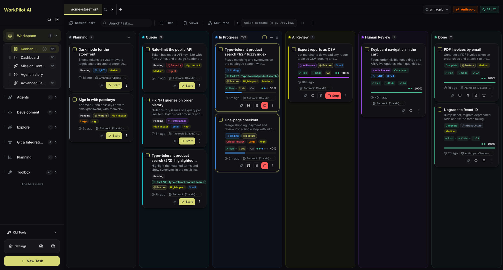

**[Download](#download)** · **[Quick start](#quick-start)** · **[How it works](#how-it-works)** · **[Tour](#a-tour-of-the-app)** · **[Features](#features-at-a-glance)** · **[AI providers](#ai-providers)** · **[Documentation](#documentation)**

WorkPilot AI is a desktop app (Windows, macOS, Linux) with a Python engine, an optional team server and a phone app. It works on any stack: .NET, Java, Kotlin, Go, Rust, Python, Node.js and TypeScript (Angular, React, Vue, Next.js, Nuxt…), PHP, Ruby, Flutter, Swift and more.

---

## Download

### Stable Release

<!-- STABLE_VERSION_BADGE -->
[](https://github.com/krovomi/WorkPilot-AI/releases/tag/v1.4.0)
<!-- STABLE_VERSION_BADGE_END -->

<!-- STABLE_DOWNLOADS -->
| Platform | Download |
|----------|----------|
| **Windows** | [WorkPilot-AI-1.4.0-win32-x64.exe](https://github.com/krovomi/WorkPilot-AI/releases/download/v1.4.0/WorkPilot-AI-1.4.0-win32-x64.exe) |
| **macOS (Apple Silicon)** | [WorkPilot-AI-1.4.0-darwin-arm64.dmg](https://github.com/krovomi/WorkPilot-AI/releases/download/v1.4.0/WorkPilot-AI-1.4.0-darwin-arm64.dmg) |
| **macOS (Intel)** | [WorkPilot-AI-1.4.0-darwin-x64.dmg](https://github.com/krovomi/WorkPilot-AI/releases/download/v1.4.0/WorkPilot-AI-1.4.0-darwin-x64.dmg) |
| **Linux** | [WorkPilot-AI-1.4.0-linux-x86_64.AppImage](https://github.com/krovomi/WorkPilot-AI/releases/download/v1.4.0/WorkPilot-AI-1.4.0-linux-x86_64.AppImage) |
| **Linux (Debian)** | [WorkPilot-AI-1.4.0-linux-amd64.deb](https://github.com/krovomi/WorkPilot-AI/releases/download/v1.4.0/WorkPilot-AI-1.4.0-linux-amd64.deb) |
| **Linux (Flatpak)** | [WorkPilot-AI-1.4.0-linux-x86_64.flatpak](https://github.com/krovomi/WorkPilot-AI/releases/download/v1.4.0/WorkPilot-AI-1.4.0-linux-x86_64.flatpak) |
<!-- STABLE_DOWNLOADS_END -->

### Beta Release

> Beta releases may contain bugs and breaking changes. [View all releases](https://github.com/krovomi/WorkPilot-AI/releases)

<!-- BETA_VERSION_BADGE -->
[](https://github.com/krovomi/WorkPilot-AI/releases)
<!-- BETA_VERSION_BADGE_END -->

<!-- BETA_DOWNLOADS -->
_No beta build is currently published. The table above is the latest stable release._
<!-- BETA_DOWNLOADS_END -->

> All releases include SHA256 checksums, a CycloneDX SBOM (`workpilot-sbom.cdx.json`) and a build provenance attestation for each file (`gh attestation verify <file> --repo krovomi/WorkPilot-AI`); VirusTotal scan results are added to the release notes when the scan is configured.


---

## Quick start

1. **Install** the app for your platform from the [download table](#download).
2. **Open a project**: any folder that is a git repository.
3. **Connect an AI provider**: a Claude subscription, an API key (OpenAI, Gemini, Grok, Mistral, DeepSeek), GitHub Copilot, a local model (Ollama, LM Studio) or an agent CLI (Codex, OpenCode, pi…).
4. **Create a task** on the Kanban board and describe what you want.
5. **Review the result**: the agents plan, code and validate; you approve the plan if you want to, then review the diff and merge.

From source (Node.js 22.12+, pnpm, Python 3.12+, Git):

```sh
git clone https://github.com/krovomi/WorkPilot-AI.git
cd WorkPilot-AI
pnpm install
pnpm run dev
```

Step-by-step installation, provider setup, Windows notes and troubleshooting: [docs/INSTALLATION.md](docs/INSTALLATION.md) (in French).

---

## How it works

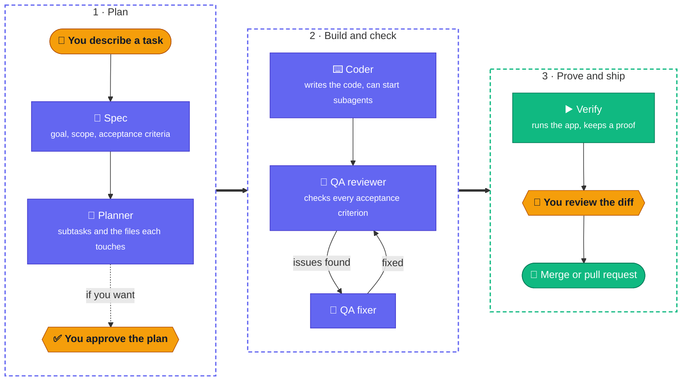

- **Isolated**: every task runs in its own git worktree, so your branch stays untouched until you merge.
- **One workflow per kind of task**: a bug is reproduced before it is fixed, an investigation writes a report and no code, a refactoring may not touch the tests, a hotfix gets an independent review ([task kinds](docs/architecture/kanban-task-types.md)).
- **Small pull requests**: a task bigger than the review ceiling of its kind splits itself into parts, one small PR each, stacked when they depend on each other ([task split](docs/architecture/task-split.md)).
- **Proof, not opinion**: after QA, the app the task changed is started and driven (web, Electron, mobile emulator, API, Windows desktop), and hard gates check the dependencies added and that the tests really catch faults.
- **Any engine**: change provider, model or effort per task, even mid-task; what each provider can do is declared in [`capabilities/providers.yaml`](capabilities/providers.yaml).

---

## A tour of the app

> Every screenshot comes from the real app, filled with an invented demo project (`acme-storefront`), and is regenerated by [`scripts/readme-screenshots/`](scripts/readme-screenshots/).

**Kanban board** (above): describe a task and follow it from planning to the pull request. Each card shows its phase, its progress, the provider at work and what it is about; the parts of a split task share a colour and a « Part k/N » mark. Columns follow the pipeline: Planning, Queue, In Progress, AI Review, Human Review, Done, plus Red Build when the project's CI fails on a task branch.

<table>
<tr>
<td width="50%" valign="top">

**Task detail**: the plan split into subtasks with the files each touches, logs, changed files, visual proofs and the emulator.

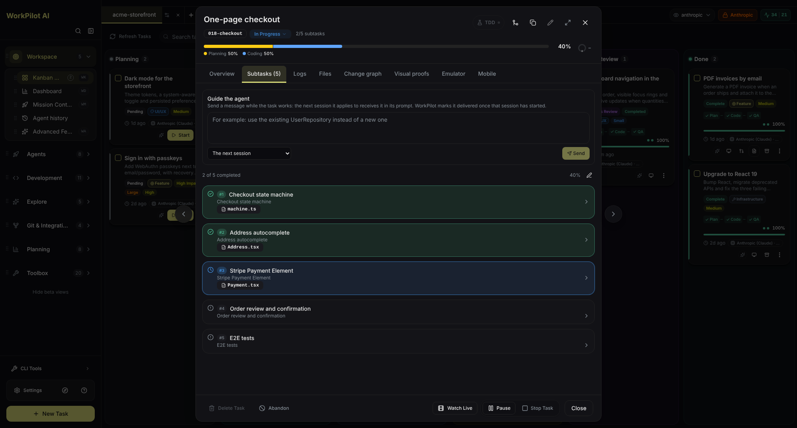

</td>
<td width="50%" valign="top">

**Agent terminals**: up to 12 terminals side by side, each in a task's worktree, to run agents in parallel by hand.

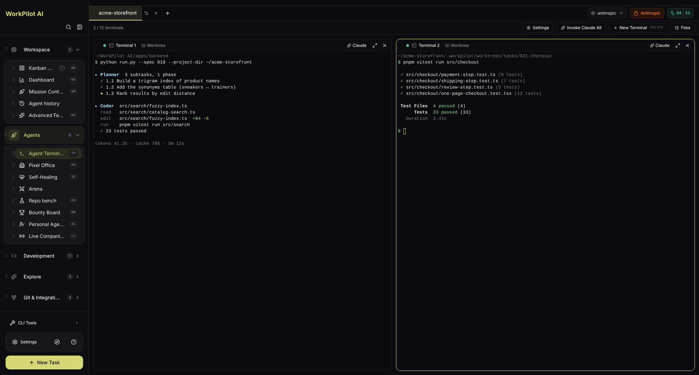

</td>
</tr>
<tr>
<td valign="top">

**Insights**: ask about your codebase; answers cite files and lines, and a finding becomes a task in one click.

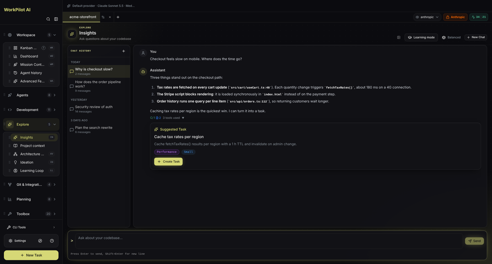

</td>
<td valign="top">

**Roadmap**: product vision, phases, MoSCoW priorities, competitors and votes; any feature becomes a task with **Build**.

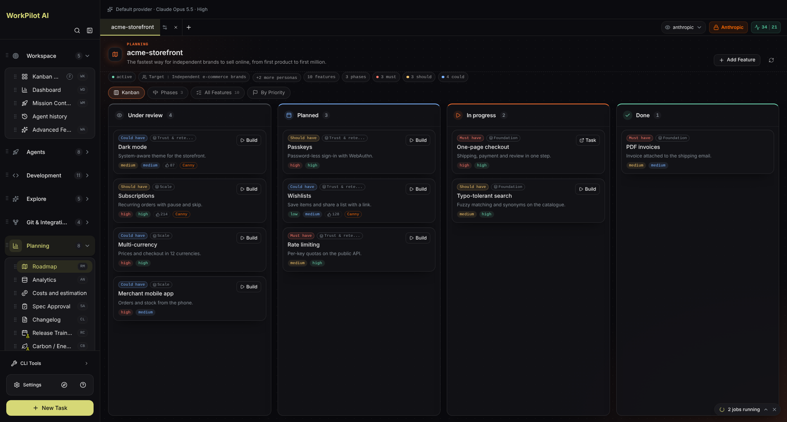

</td>
</tr>
<tr>
<td valign="top">

**Ideation**: agents scan the project and propose improvements by type, each with its rationale and files.

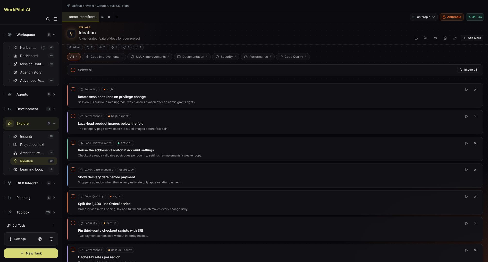

</td>
<td valign="top">

**Dashboard**: what the agents produce and cost, by status, provider and model; exportable as JSON or CSV.

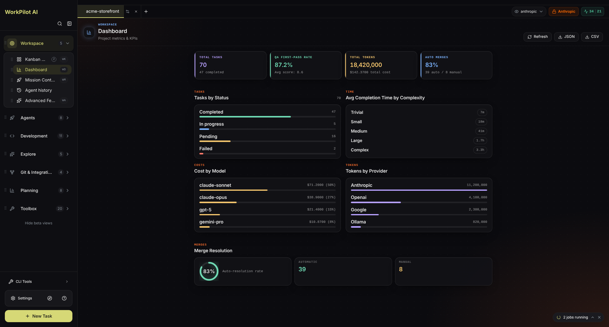

</td>
</tr>
<tr>
<td valign="top">

**Visual to Code**: draw the architecture as a node graph, each connection explained and checked, then generate the project.

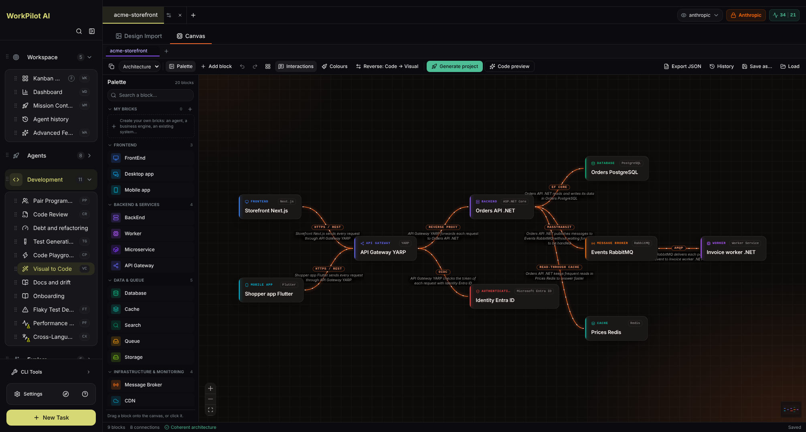

</td>
<td valign="top">

**Import Design**: a mockup, screenshot or Figma export becomes components of the project's stack, in six visible steps.

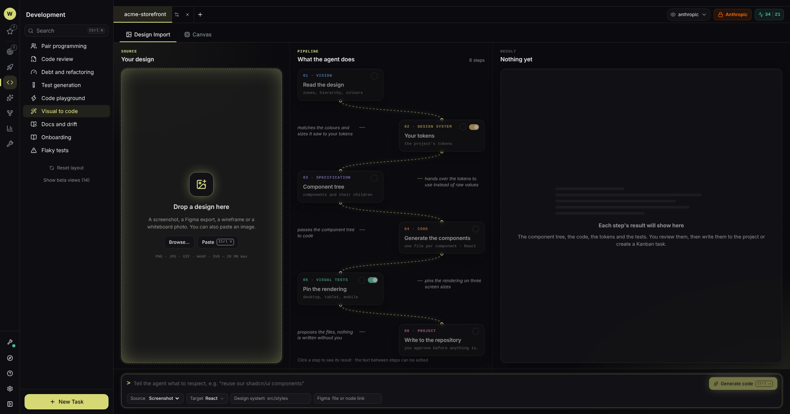

</td>
</tr>
<tr>
<td valign="top">

**Test generation studio**: coverage gaps, unit, E2E or TDD, written live in the framework of the file's own stack.

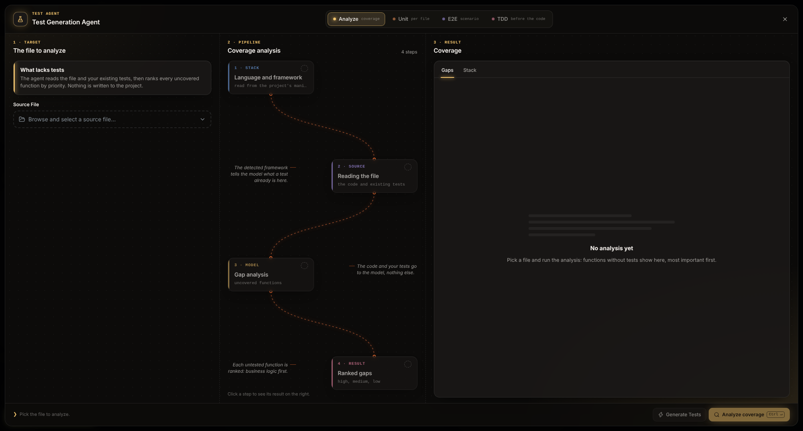

</td>
<td valign="top">

**Settings**: application and project settings grouped by theme, in the same design charter as every module, in the colours of the active theme.

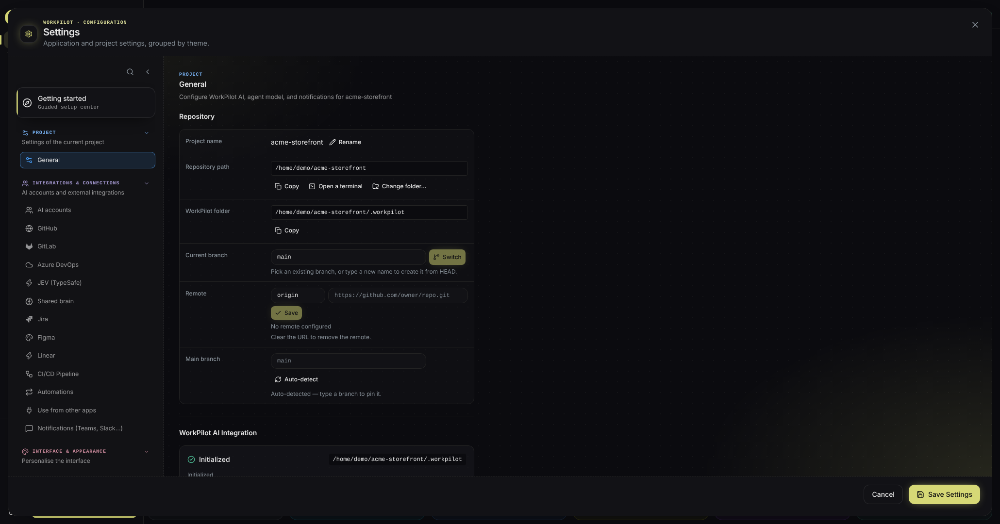

</td>
</tr>
</table>

**Mobile app (iOS and Android)**: with a team server, the shared board in your pocket: open a card, approve a plan, start or stop the agents, read the dashboard, Insights, roadmap and ideas.

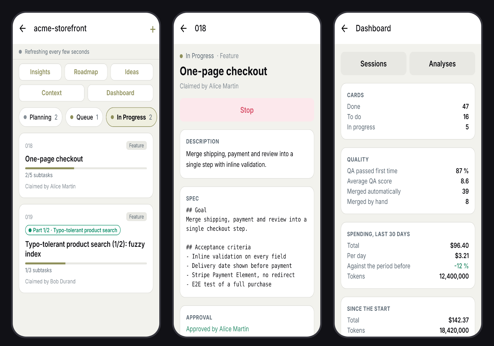

---

## Features at a glance

The full list, with every detail, is in **[docs/FEATURES.md](docs/FEATURES.md)**. Views marked _experimental_ in the sidebar (a flask on their icon) have no design document or test yet; one button hides them all.

**Build pipeline**
- **Kanban board** with spec approval, pause and resume, per-phase re-run, steering messages while the agent works, and a guided review with line comments sent back to the fixer.
- **Automatic split** of big tasks into small grouped PRs, **stacked tasks**, **Best-of-N** (build a task 2 to 4 times on different engines and keep the best) and **multi-repo** changes.
- **Goal mode** (done when a command says so, e.g. `dotnet test` exits 0), **cross review** by a second engine, **spec by example** for ASP.NET Core Web APIs, **.NET upgrades** one release at a time up to .NET 11.
- **Runtime verification** with proof videos and a comparison against the base branch; **hard gates** for invented packages, toothless tests and formal proofs.
- **PR follow-through**: a red check or a review thread on the task's PR goes back to the fixer, never forced, never merged.
- **Provenance**: which lines the AI wrote and with which model, an SBOM of the packages added, requirement-to-test traceability.

**Agents and orchestration**
- **Mission Control** to run several agents on one goal, **agent terminals**, **Arena** and **Bounty Board** to compare engines, **Repo bench** to measure them on your own past tasks.
- Specialised agents: test generator, flaky test detective, refactorer, docs and drift, migration, release coordinator, self-healing on CI failures, technical debt tracker.
- **Shared memory**: one Obsidian vault and graph every agent reads and writes, across sessions and providers; provider-agnostic **skills** packs.

**Understand and plan**
- **Insights**, **Ideation**, **Roadmap**, architecture visualizer, code review rules and code smells for every major stack, risk classifier.
- **Visual to Code**, **Import Design**, **pipeline generator** (GitHub Actions, GitLab CI, Azure Pipelines, Bitbucket, CircleCI) and a **voice assistant** (Ctrl+Shift+Space).

**Integrations**
- GitHub, GitLab, Azure DevOps, Jira and Linear: import issues, investigate them, review pull requests.
- **Automations** turn an event (an issue labelled, CI red, a time of day) into a draft card.
- MCP marketplace and custom MCP servers with pinned tool descriptions; the **workpilot-board** MCP server gives Claude Code, Codex, Gemini CLI, Copilot, Cursor and others your Kanban.
- Notifications on Slack, Teams, Discord, Google Chat, webhooks, ntfy and Telegram.

**Team**
- **Server mode**: one server for the team, every feature shared live, organisations isolated, roles, groups and admins, JWT or Microsoft Entra sign-in ([operations guide](docs/server-operations.md)).
- **Mobile app** for iOS and Android, team chat, invitation-only sign-up.

**Cost and monitoring**
- Analytics dashboard, cost estimator, Formula Lab (cost and success estimate per provider, model and effort), rate-limit monitor with account switching, carbon profiler, OpenTelemetry GenAI traces for every provider.

**Look and feel**
- One UI charter across every module that follows the active theme: 7 colour themes in light and dark plus a theme editor, command palette, full English and French interface.

---

## AI providers

| Provider | Sign-in |
|----------|---------|
| **Anthropic Claude** | Claude Code sign-in (subscription), or an API profile: a base URL and its token |
| **OpenAI** | API key, or the signed-in Codex CLI |
| **Google Gemini** | API key, or Gemini CLI through the Agent Client Protocol |
| **Grok (xAI)**, **Mistral**, **DeepSeek** | API key |
| **GitHub Copilot** | GitHub sign-in (Copilot subscription) |
| **Windsurf** | API key, or the key of the installed Windsurf IDE |
| **Local models** | Ollama, LM Studio or llama.cpp, no key |
| **Agent CLIs** | Codex, OpenCode, Antigravity, pi, Hermes: installed and updated in one click from the **CLI Tools** sidebar |

Several accounts per provider can be registered; when one hits its rate limit, the next one takes over. Keys are stored in the OS keyring and shown masked; the interface never receives their value. Meta, AWS and Cursor can be configured but have no agent client yet: their builds run on Claude, and the task says so. Variables and defaults: [docs/CONFIGURATION.md](docs/CONFIGURATION.md).

---

## Architecture

How the pieces talk to each other:

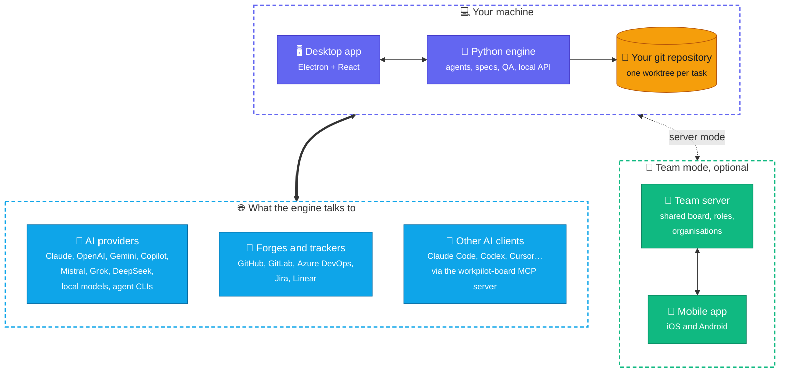

Where they live in the repository:

| Folder | What it holds |
|---|---|
| `apps/backend/` | Python agents, specs, QA, local API, server mode |
| `apps/frontend/` | Electron desktop app (React + TypeScript) |
| `apps/mobile/` | iOS and Android app (Expo), client of server mode |
| `src/` | Shared Python connectors (Jira, Azure DevOps…) |
| `capabilities/` | What each provider and harness can do |
| `config/` | Provider list shown in Settings |
| `workflows/` | One declarative workflow per task kind |
| `skills/` | Skill packs (`.agents/skills/` is generated) |
| `deploy/` | Server image and docker-compose |
| `changelog.d/` | One changelog fragment per pull request |
| `docs/` | Rules, design rationale, guides |
| `tests/` | Python tests (frontend tests sit next to the code) |
| `scripts/` | Build, release and maintenance scripts |

How the pieces fit (agents, subagents, workflows, state, security layers): [docs/ARCHITECTURE.md](docs/ARCHITECTURE.md) (in French). Why each feature is built the way it is: [docs/architecture/](docs/architecture/). A guided, clickable atlas readable without a technical background: [docs/audit/WorkPilot-architecture.html](docs/audit/WorkPilot-architecture.html). Instructions for coding agents start at [`AGENTS.md`](AGENTS.md).

### Command line

```bash
cd apps/backend
python runners/spec_runner.py --interactive   # Create a spec interactively
python run.py --spec 001                      # Run autonomous build
python run.py --spec 001 --review             # Review
python run.py --spec 001 --merge              # Merge
```

Full reference: [docs/CLI-USAGE.md](docs/CLI-USAGE.md).

---

## Security

1. **OS sandbox**: agent commands run under bubblewrap (Linux) or Seatbelt (macOS); Windows is not covered yet, and the card says when a task runs without a sandbox.
2. **Filesystem restrictions**: operations stay inside the project directory.
3. **Dynamic command allowlist**: only the commands of the detected stack are allowed.

API keys and tokens are encrypted at rest with the OS keyring; Settings > Accounts shows how long ago each API key was saved and suggests renewing it after 90 days. Every release ships SHA256 checksums, a CycloneDX SBOM and a build provenance attestation per file.

To report a vulnerability, follow [docs/SECURITY.md](docs/SECURITY.md), never a public issue. The rules contributors and coding agents follow are in [docs/rules/security.md](docs/rules/security.md).

---

## Documentation

| Document | What it covers |
|----------|----------------|
| [Features](docs/FEATURES.md) | Every feature, by area |
| [Installation](docs/INSTALLATION.md) | Requirements, install methods, provider setup, Windows notes, troubleshooting (in French) |
| [Configuration](docs/CONFIGURATION.md) | Provider registry, credential resolution, environment variables |
| [CLI usage](docs/CLI-USAGE.md) | Headless and CI usage |
| [Architecture](docs/ARCHITECTURE.md) | Agents, workflows, state and security layers (in French) |
| [Design rationale](docs/architecture/) | Why each feature is built the way it is, one file per feature |
| [Server operations](docs/server-operations.md) | Running the team server: deployment, TLS, backups, upgrades, quotas (in French) |
| [Linux](docs/linux.md) · [Windows development](docs/windows-development.md) | Platform notes |
| [Contributing](docs/CONTRIBUTING.md) | Development setup, code style, tests, pull requests |
| [Release process](docs/RELEASE.md) | How releases are cut and published |
| [Security policy](docs/SECURITY.md) | Supported versions, reporting a vulnerability |
| [Documentation map](docs/README.md) | Where every document lives and what it is for |
| [Wiki](https://github.com/krovomi/WorkPilot-AI/wiki) | User guides, refreshed after each release |

---

## Contributing and community

Contributions are welcome: start with [docs/CONTRIBUTING.md](docs/CONTRIBUTING.md). Pull requests target `develop`.

- **Issues**: [report a bug or request a feature](https://github.com/krovomi/WorkPilot-AI/issues)
- **Discussions**: [ask a question](https://github.com/krovomi/WorkPilot-AI/discussions)

---

## License

**AGPL-3.0**, GNU Affero General Public License v3.0. WorkPilot AI is free to use. If you modify and distribute it, or run it as a service, your code must also be open source under AGPL-3.0. Commercial licensing is available for closed-source use cases.

[](https://github.com/krovomi/WorkPilot-AI/stargazers)

[](https://star-history.com/#krovomi/WorkPilot-AI&Date)
